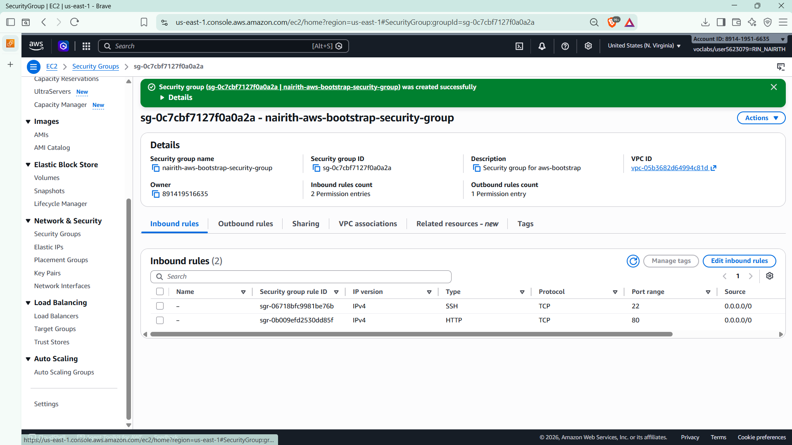
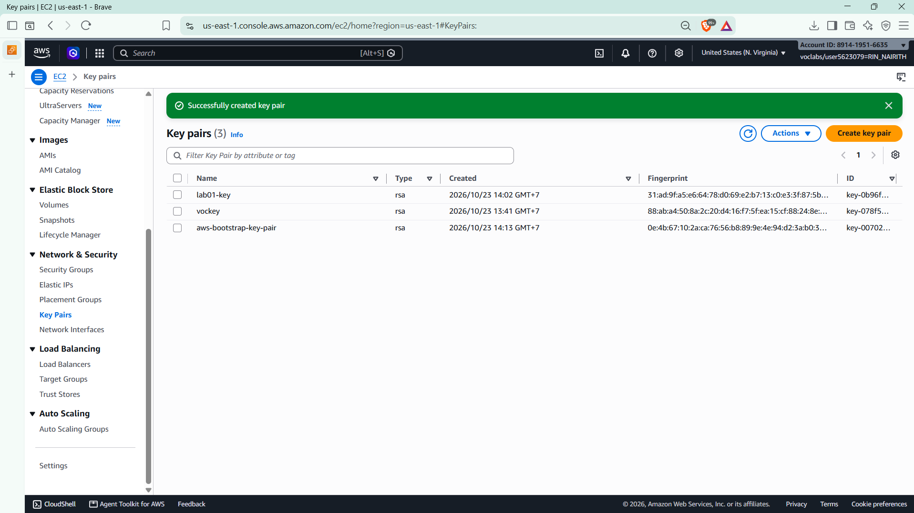
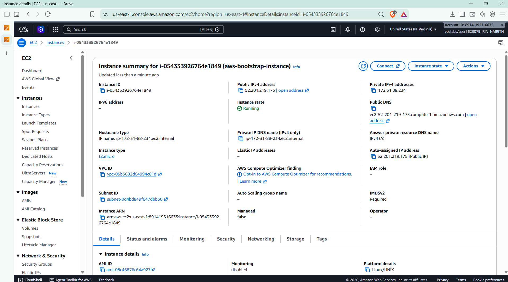
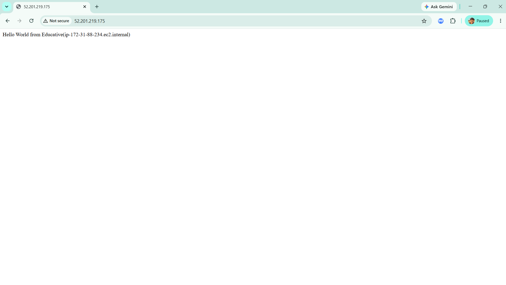
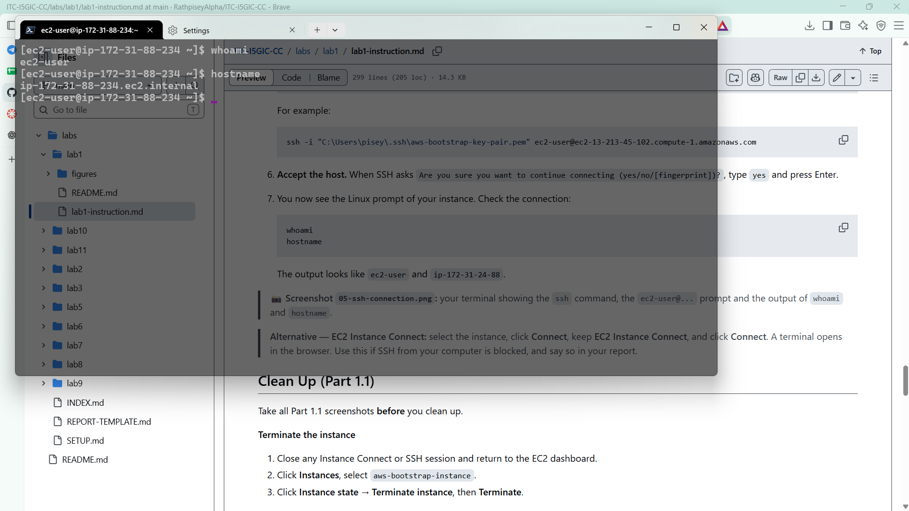
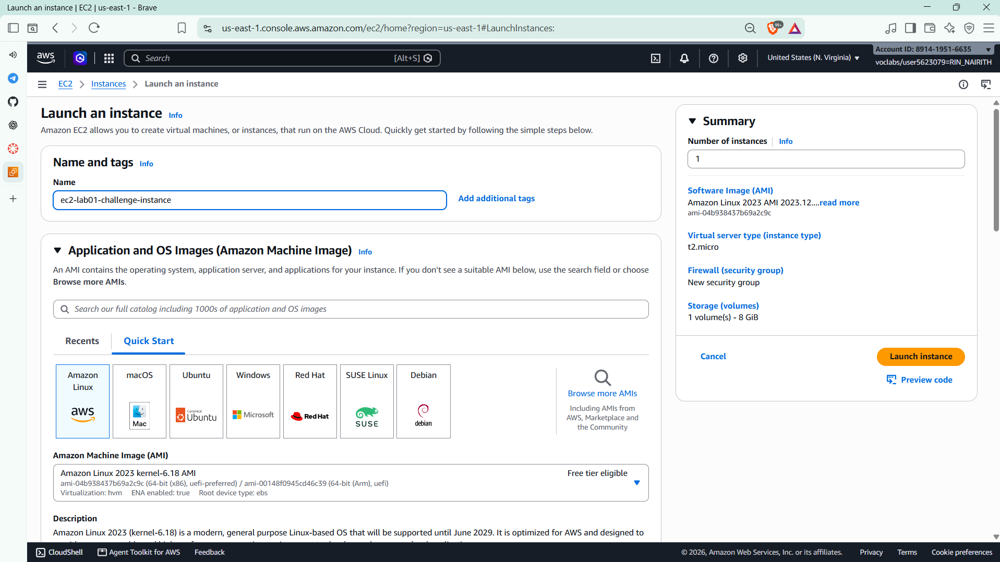
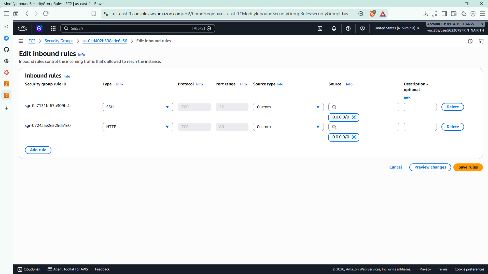
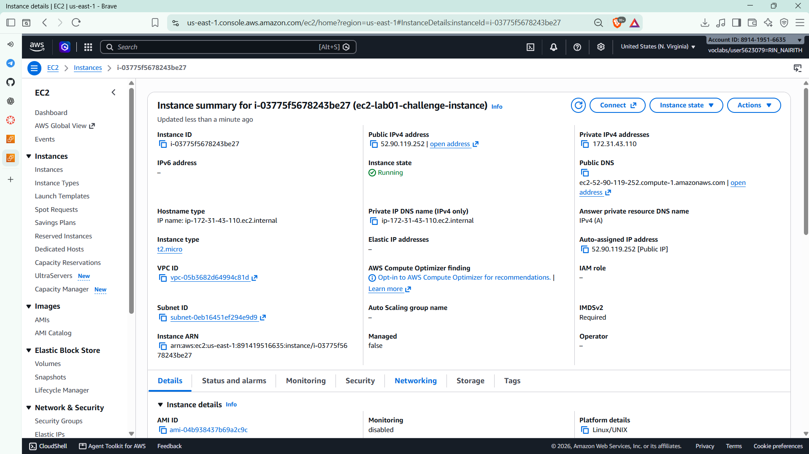
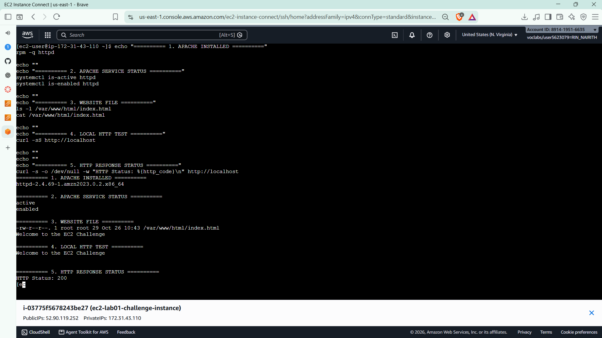
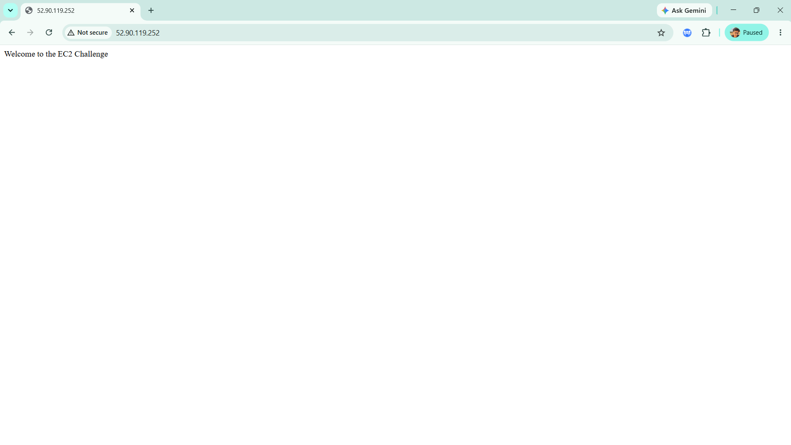

# Cloud Lab 1 Submission: Amazon EC2

| | |
| --- | --- |
| **Student name** | Rin Nairith |
| **Student ID** | e20221557 |
| **Learner Lab user name** | voclabs/user5623079=RIN_NAIRITH |
| **Date completed** | 2026-10-26 |
| **Region** | US East (N. Virginia) `us-east-1` |

---

## Part 1.1: An Amazon EC2 Walkthrough

### Security group



### Key pair



### Instance details



### Browser test



### SSH connection



> Connected with my own SSH client (Windows Terminal + `.pem` key).

---

## Part 1.2: EC2 Web Solution (Challenge)

### Launch configuration



### Security group



### Running instance



### Commands on the instance



```bash
# Install and start Apache
sudo dnf install -y httpd
sudo systemctl start httpd
sudo systemctl enable httpd

# Create the web page
echo "Welcome to the EC2 Challenge" | sudo tee /var/www/html/index.html

# Verify
rpm -q httpd
systemctl is-active httpd
systemctl is-enabled httpd
ls -l /var/www/html/index.html
cat /var/www/html/index.html
curl -sS http://localhost
curl -s -o /dev/null -w "HTTP Status: %{http_code}\n" http://localhost
```

### Browser test



---

## Questions

1. **SSH rule vs HTTP rule**: SSH (TCP 22) lets me log in to the instance's terminal; HTTP (TCP 80) lets browsers load the web page. Without the HTTP rule the page times out, but SSH still works.
2. **Who installed the web server in Part 1.1?** The user data (bootstrap) script, run once by cloud-init as root on the instance's first boot.
3. **Why `http://` but not `https://`?** Apache only listens on port 80; there is no TLS certificate, nothing on port 443, and no security group rule for 443.
4. **10 GiB root volume**: Set in **Configure storage** during launch. Check on the instance with `lsblk` or `df -h /`.

---

## Clean up

- [x] Part 1.1: instance terminated, key pair and security group deleted.
- [x] Part 1.2: instance terminated, security group (and key pair, if any) deleted.
