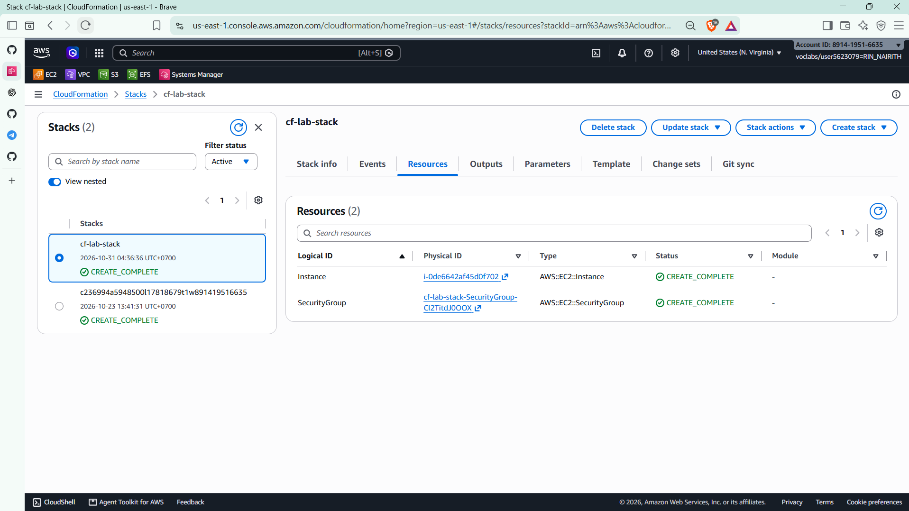
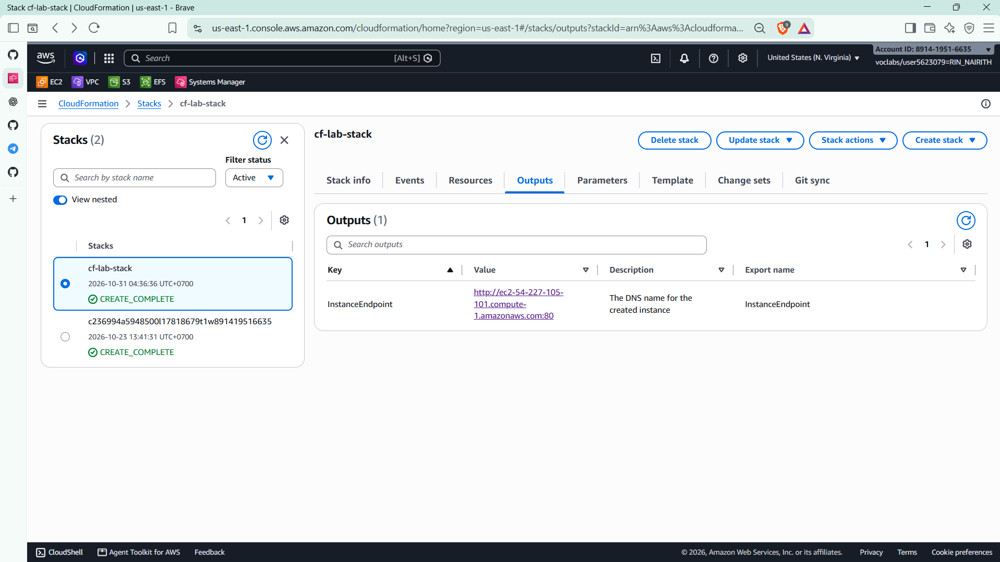
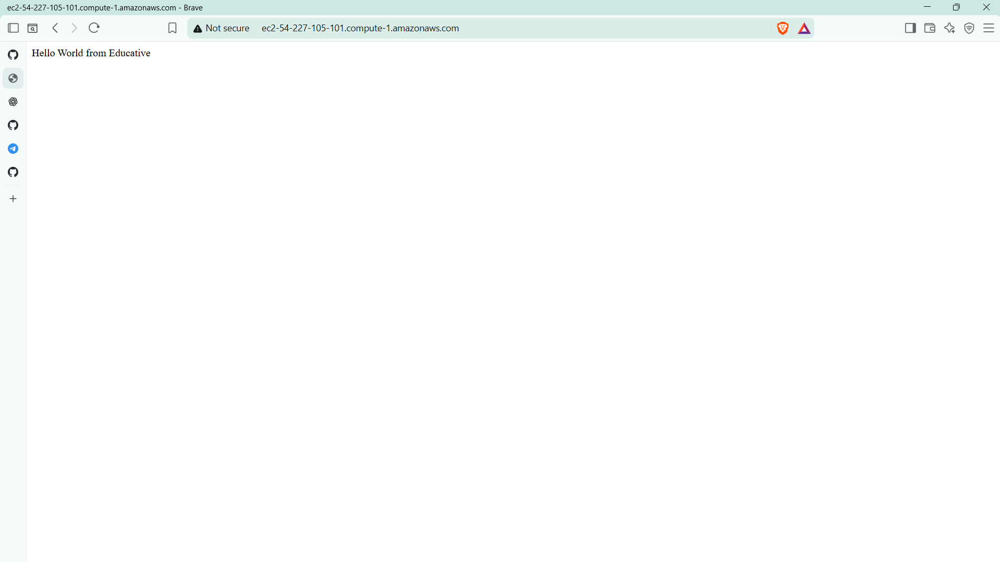
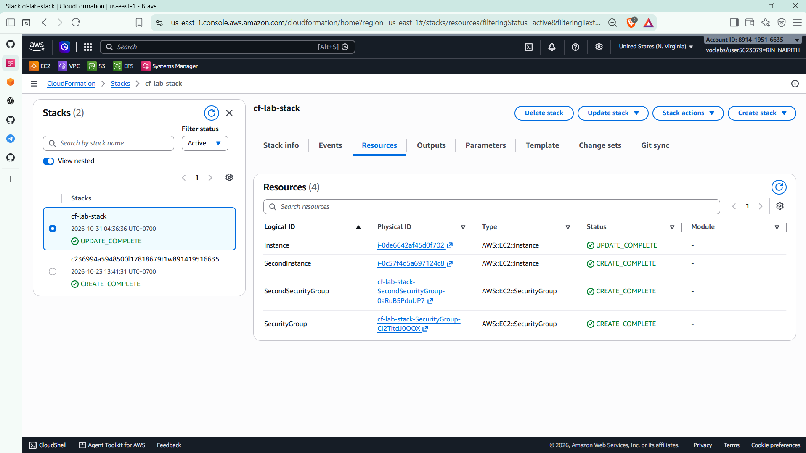
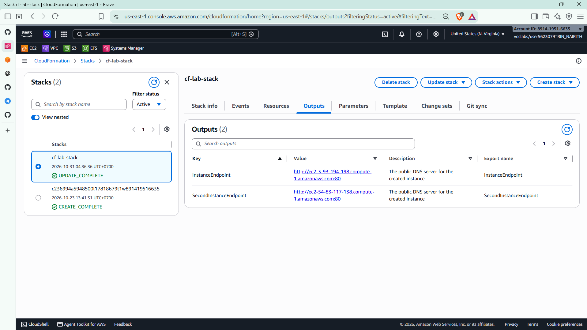
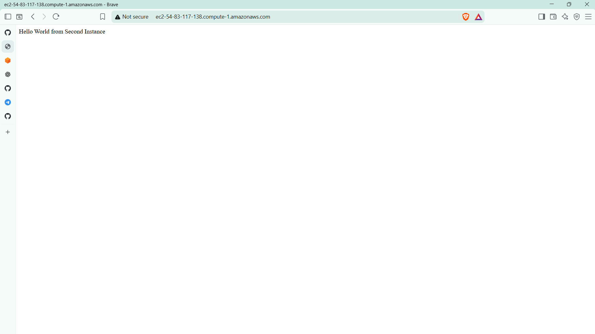

# Cloud Lab 10 Submission: CloudFormation

| | |
| --- | --- |
| **Student name** | Rin Nairith |
| **Student ID** | e20221557 |
| **Learner Lab user name** | voclabs/user5623079=RIN_NAIRITH |
| **CloudFormation stack** | `cf-lab-stack` |
| **Date completed (Part 10.1)** | 2026-10-31 |
| **Region** | US East (N. Virginia) `us-east-1` |

> Part 10.1 complete. Part 10.2 (Terraform) paused.

---

## Part 10.1 — CloudFormation

`cf-lab-stack` created a `t2.micro` EC2 instance and a security group allowing HTTP `80` and SSH `22`.

`InstanceEndpoint`: `http://ec2-54-227-105-101.compute-1.amazonaws.com:80`

**Hello World from Educative**

### Updated stack

The update added `SecondInstance` and `SecondSecurityGroup`. Stack status: `UPDATE_COMPLETE`.

| Output | Endpoint |
| --- | --- |
| `InstanceEndpoint` | `http://ec2-3-93-194-198.compute-1.amazonaws.com:80` |
| `SecondInstanceEndpoint` | `http://ec2-54-83-117-138.compute-1.amazonaws.com:80` |

**Hello World from Second Instance**

## Part 10.2 — paused

Terraform not completed.
