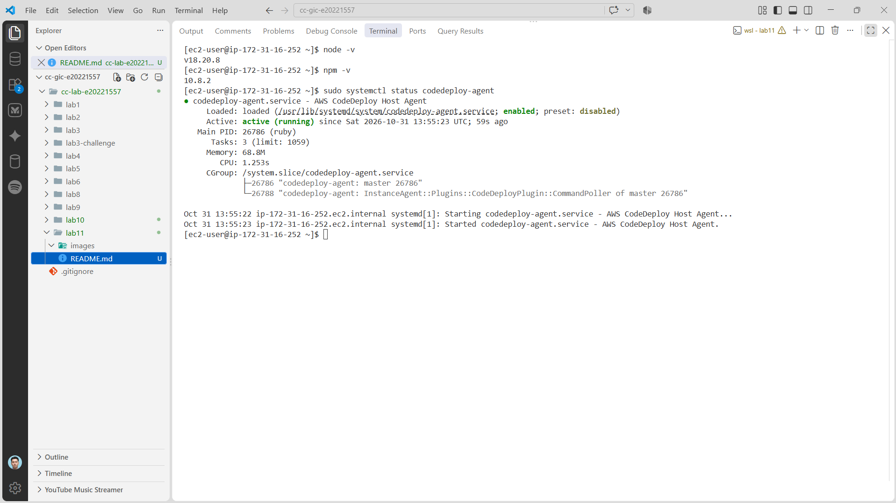

# Cloud Lab 11 Submission: CI/CD Pipeline

| | |
| --- | --- |
| **Student name** | Rin Nairith |
| **Student ID** | e20221557 |
| **Learner Lab user name** | voclabs/user5623079=RIN_NAIRITH |
| **Application repository** | <https://github.com/RITH-1437/cicd-node-app> |
| **Date attempted** | 2026-10-31 |
| **Region** | US East (N. Virginia) `us-east-1` |
| **Status** | Partially attempted; blocked |

> App pushed to GitHub and local tests pass. AWS pipeline incomplete.

---

## Application

`cicd-node-app` is pushed on `main` at `188cb66`. `npm ci` and `npm test` pass.

## Blockers

- **CodeBuild:** `codebuild:ListProjects` → `AccessDeniedException` (explicit deny in `voc-cancel-cred`); no AWS build.
- **CodeDeploy:** Application created, but no deployment group; no target instances or deployment.
- **CodePipeline:** GitHub source showed `Branches failed loading`; `main` could not be selected.

The pipeline needs CodeBuild, a deployment group, and a working GitHub source, so it could not run end to end.

## Evidence

- [x] Node app pushed to GitHub (`188cb66`)
- [x] Local `npm ci` and `npm test` pass
- [x] CodeDeploy agent visible on EC2
- [x] CodeDeploy application created
- [ ] CodeBuild build
- [ ] Deployment group and deployment
- [ ] CodePipeline execution
- [ ] Deployed app URL

## Cleanup

- [ ] Delete the CodeDeploy application and deployment group.
- [ ] Delete the CodeBuild project and CodePipeline.
- [ ] Terminate the EC2 instance running the CodeDeploy agent.
- [ ] Remove unused S3 artifacts and CloudWatch log groups.
