# Cloud Lab 2 Submission: Load Balancer and Auto Scaling

| | |
| --- | --- |
| **Student name** | Rin Nairith |
| **Student ID** | e20221557 |
| **Learner Lab user name** | voclabs/user5623079=RIN_NAIRITH |
| **Date completed** | 2026-10-28 |
| **Region** | US East (N. Virginia) `us-east-1` |

---

## Security groups

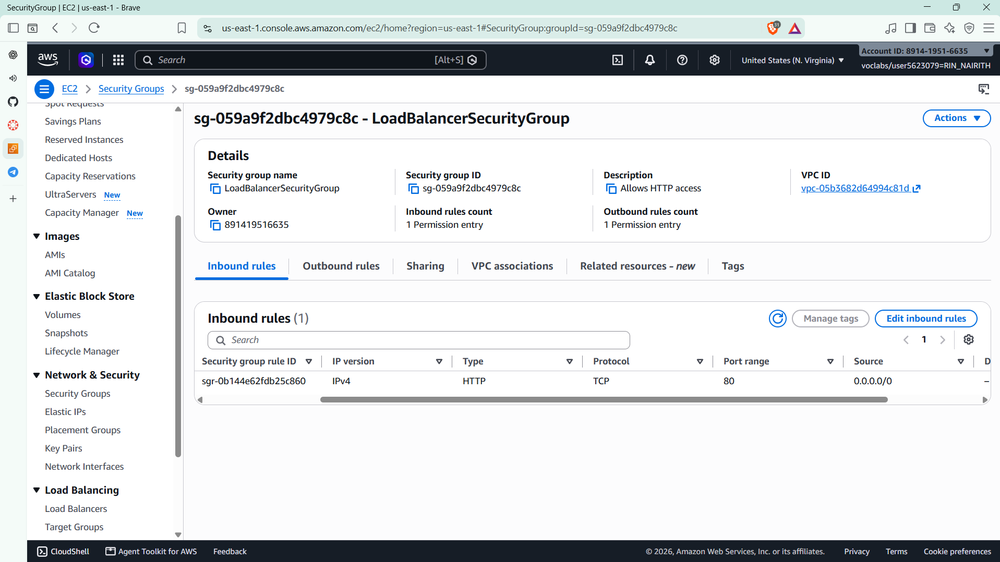

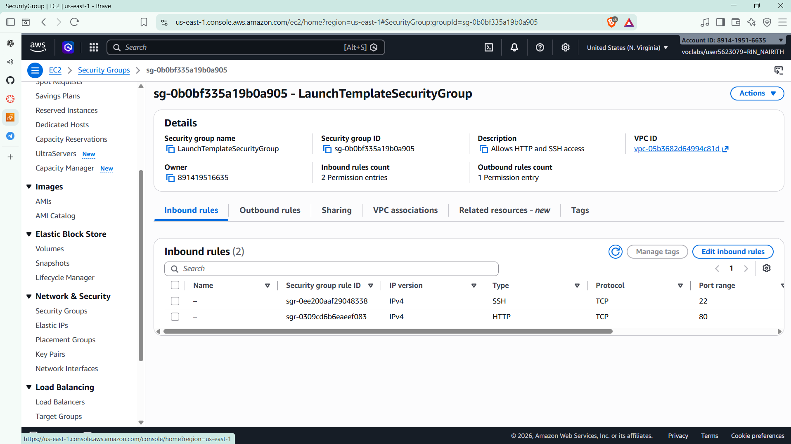

## Target group

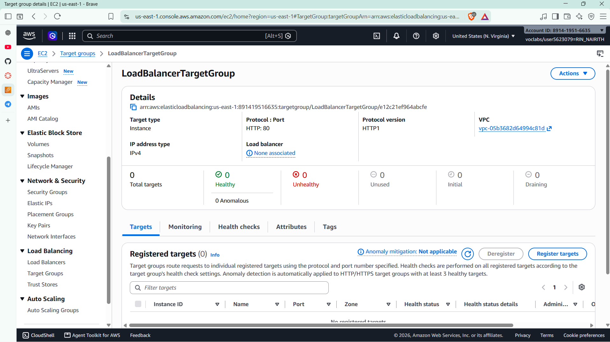

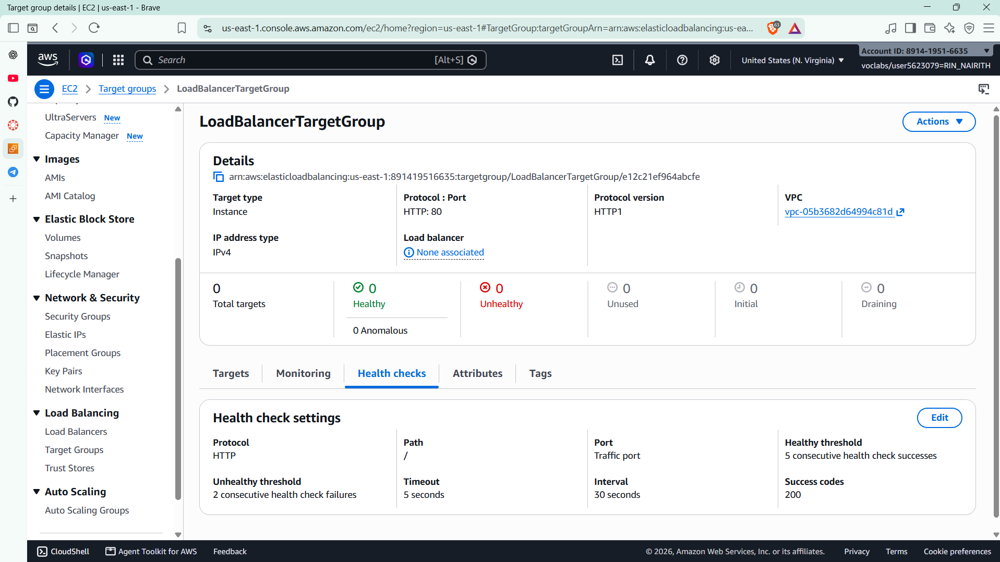

## Application Load Balancer

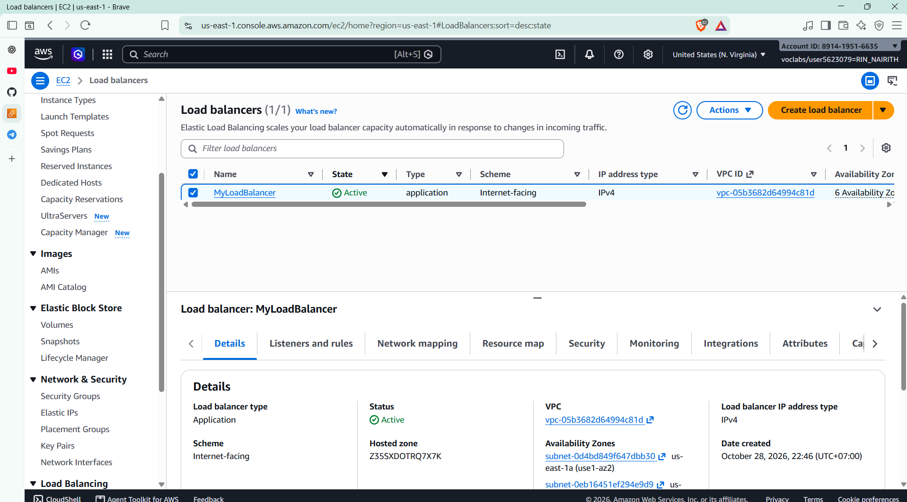

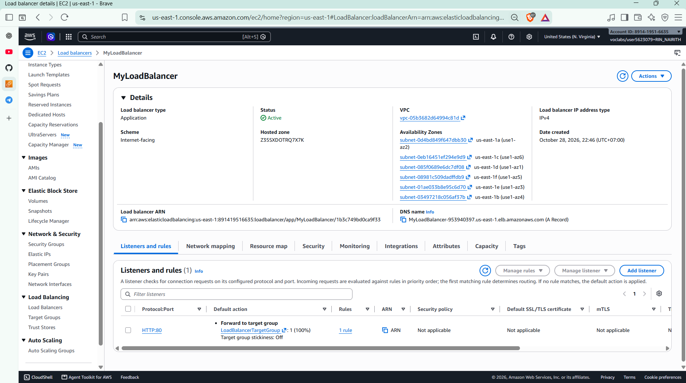

## Launch template

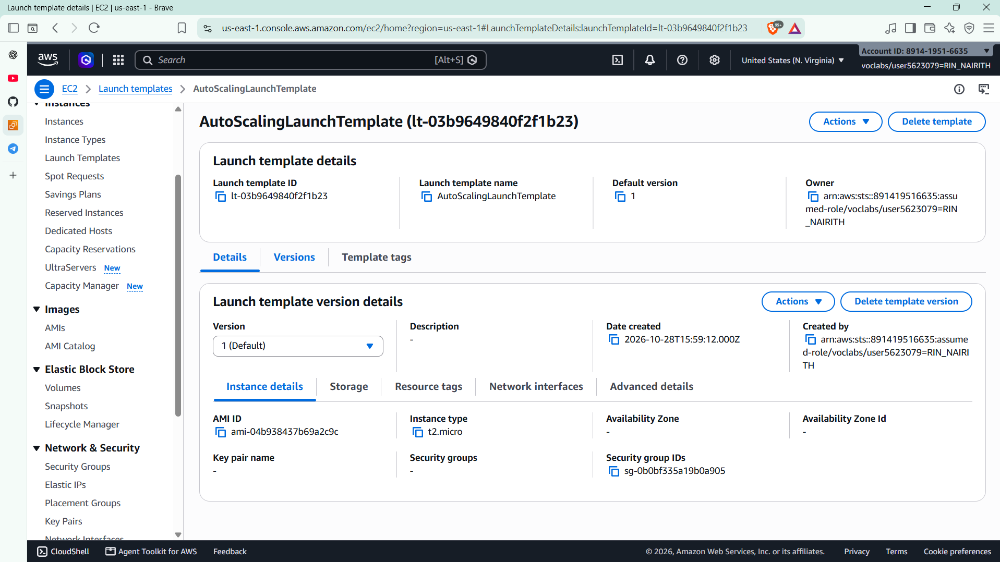

## Auto Scaling group

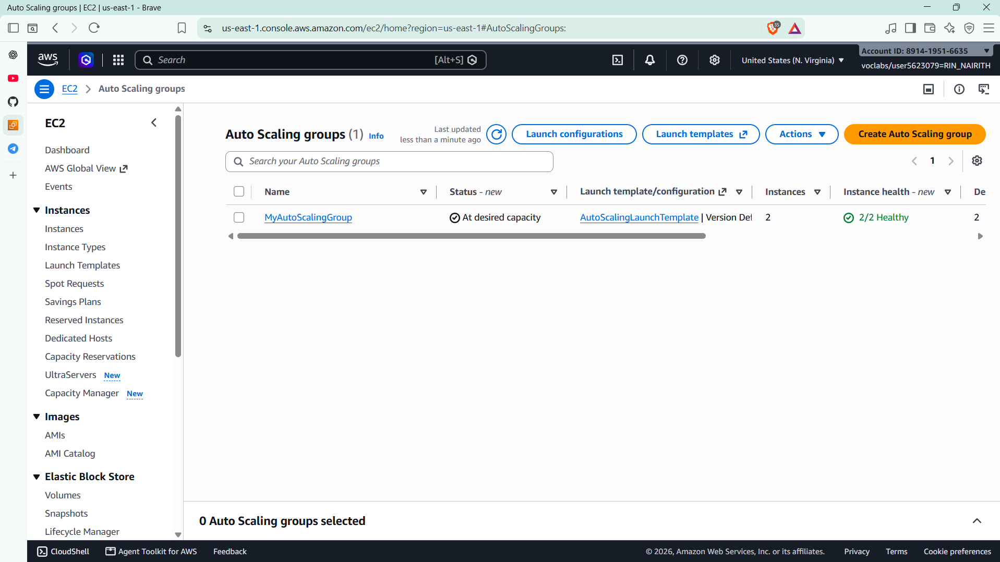

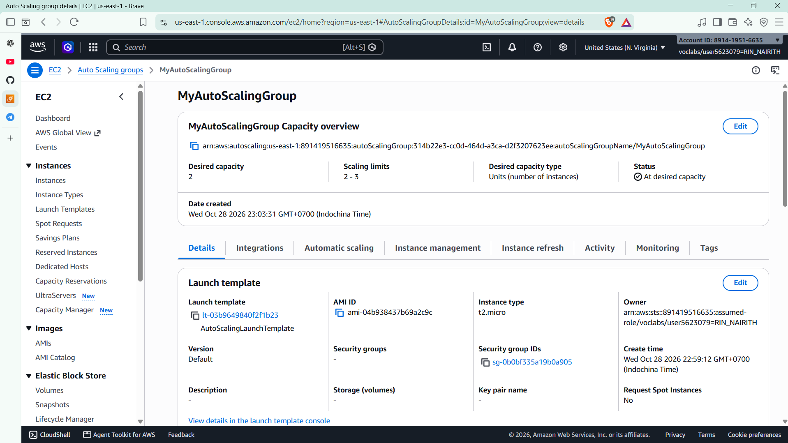

## Load balancing test

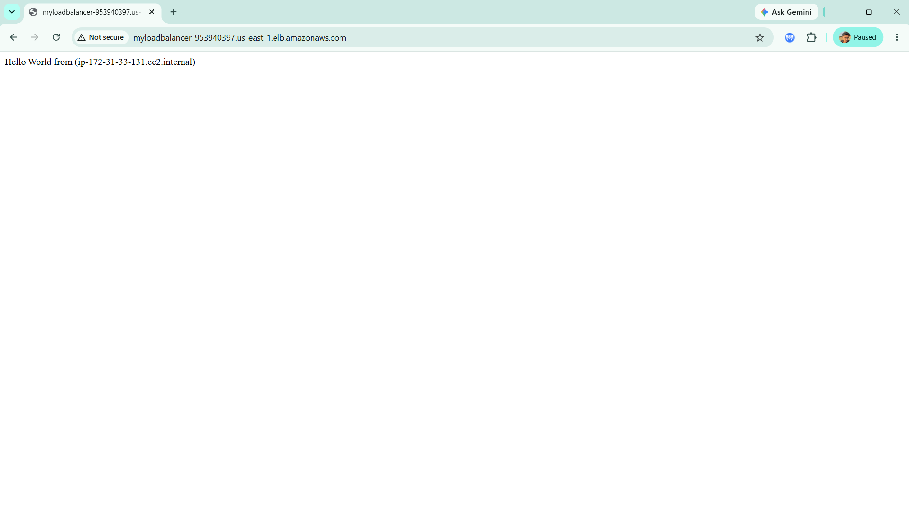

## Simulated application failure

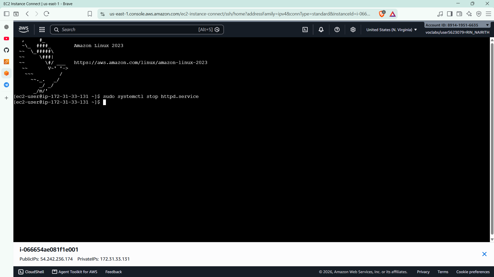

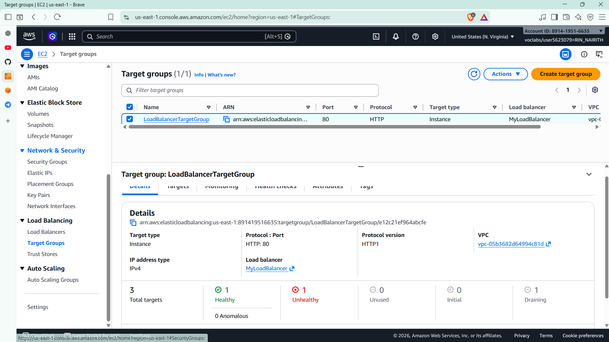

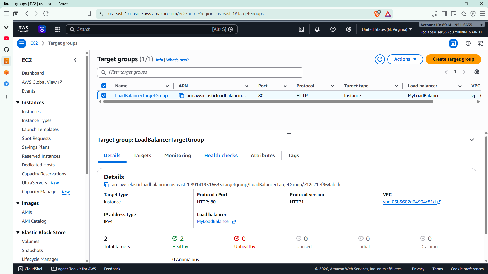

> About **6 minutes**: I stopped `httpd` at about 23:25 and the new instance was healthy at about 23:31.

---

## Questions

1. **Why a different host name on refresh?** The load balancer spreads requests across the healthy instances in the target group. Each instance's page prints its own host name (from `$(hostname)` in the user data), so a refresh can land on the other instance (`ip-172-31-8-226` and `ip-172-31-33-131`).
2. **What did the health check test?** Every 30 seconds the target group sends an HTTP request for `/` on port 80 and expects code **200**. With `httpd` stopped, nothing answered on port 80, so after **2** failed checks in a row the target was marked unhealthy. EC2 only checks that the virtual machine is running, not the web server, so it still showed *running*.
3. **Who replaced the failed instance?** The **Auto Scaling group**.
   - **Load balancer:** the single entry point; it forwards requests only to healthy targets.
   - **Target group:** holds the instances and runs the health checks; it marks a failed instance unhealthy and drains it.
   - **Auto Scaling group:** with ELB health checks turned on, it sees the unhealthy instance, terminates it and launches a new one from the launch template to stay at the desired capacity.
4. **How many instances?** Normally **2** (the desired capacity, never below the minimum of 2). There could be **3** if a scaling policy added one under high load (for example, high CPU); the maximum stops it at 3.
5. **HTTP only from the load balancer?** In `LaunchTemplateSecurityGroup`, change the HTTP rule's source from `0.0.0.0/0` to the load balancer's security group, `LoadBalancerSecurityGroup` (`sg-059a9f2dbc4979c8c`). Then only traffic coming through the load balancer can reach the instances on port 80.

---

## Clean up

- [x] `MyAutoScalingGroup` deleted and its instances terminated.
- [x] `AutoScalingLaunchTemplate` deleted.
- [x] `MyLoadBalancer` and `LoadBalancerTargetGroup` deleted.
- [x] Both security groups deleted.
