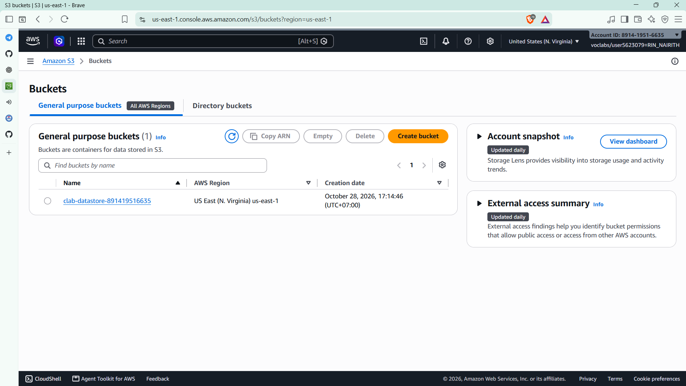
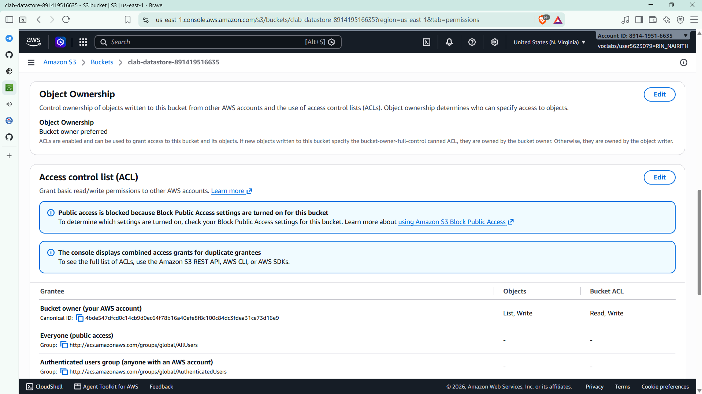
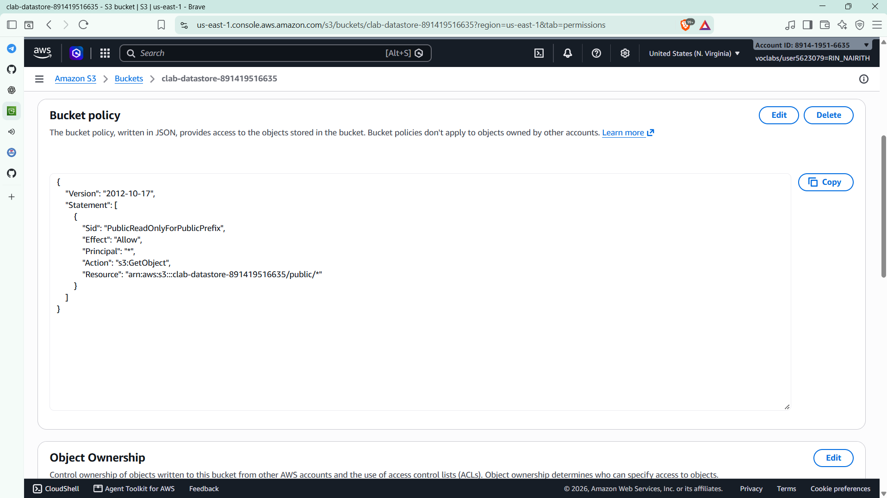
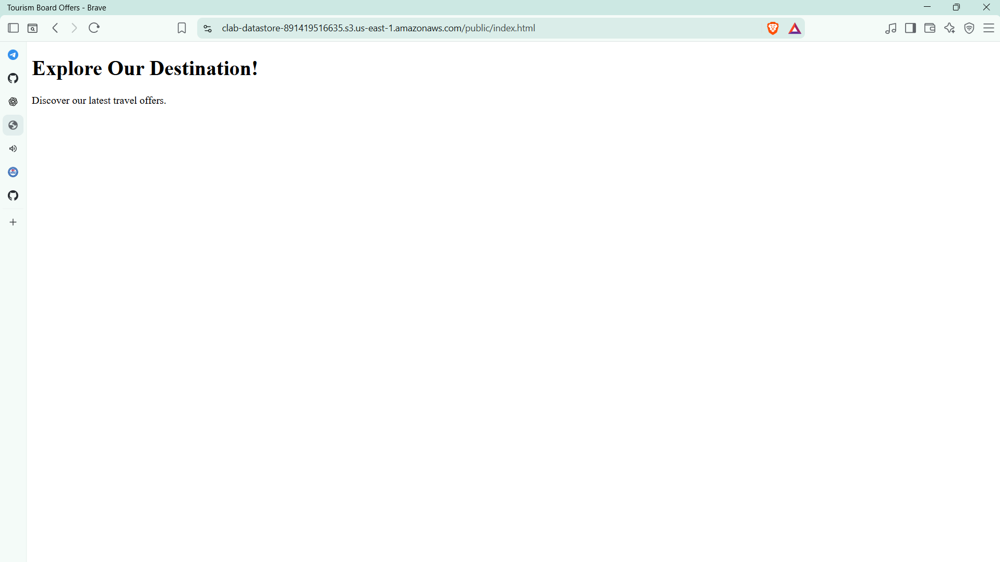
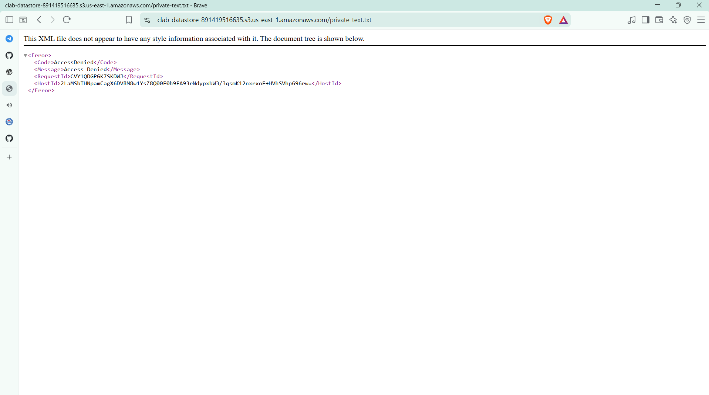
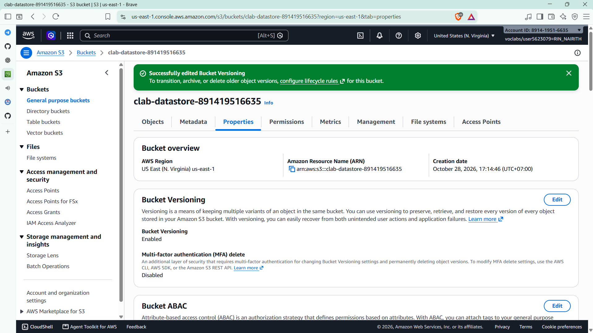
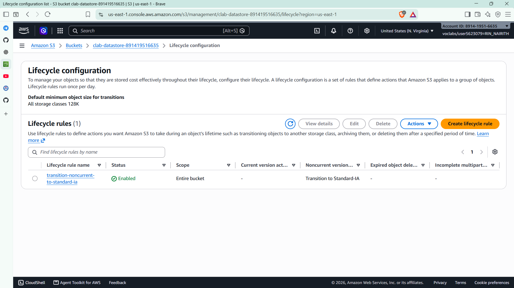

# Cloud Lab 3 Challenge Submission: Secure S3 Bucket

| | |
| --- | --- |
| **Student name** | Rin Nairith |
| **Student ID** | e20221557 |
| **Learner Lab user name** | voclabs/user5623079=RIN_NAIRITH |
| **Bucket name** | `clab-datastore-891419516635` |
| **Date completed** | 2026-10-28 |
| **Region** | US East (N. Virginia) `us-east-1` |

---

## 1. Bucket



## 2. Object ownership



## 3. Public access policy







My policy is in [bucket-policy.json](bucket-policy.json). The line that limits public access to the `public/` folder:

```json
"Resource": "arn:aws:s3:::clab-datastore-891419516635/public/*"
```

> The `Allow` applies only to object keys that start with `public/`. Objects anywhere else (such as `private-text.txt` at the root) have no `Allow`, so they stay private and return **AccessDenied**.

## 4. Versioning



## 5. Lifecycle rule



---

## Questions

1. **Why turn off parts of Block Public Access, and why is it still safe?** With Block Public Access on, S3 blocks any bucket policy that grants public access, so my policy could not take effect. It is still safe because the policy only allows `s3:GetObject` on `public/*`. Every other object has no `Allow`, so S3 denies it by default (shown in `03c`).
2. **What is a noncurrent version?** When versioning is on and an object is overwritten, the new upload becomes the *current* version and the old one is kept as a *noncurrent* version. In my test I uploaded `private-text.txt`, then uploaded an updated copy with the same name; the first copy became the noncurrent version.
3. **Why Standard-IA instead of deleting?** Old versions are rarely read but may be needed to roll back a page. Standard-IA costs less to store than Standard and still returns the file in milliseconds, so the history is kept cheaply instead of being lost.

---

## Clean up

- [ ] All object versions deleted and the bucket deleted.
