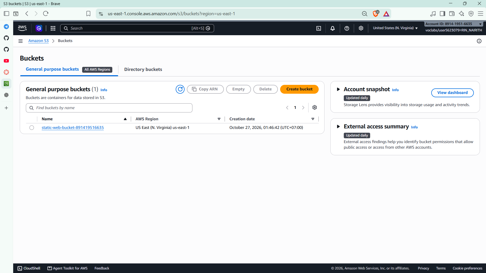
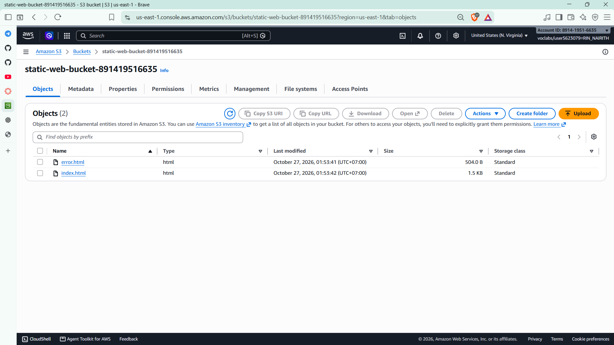
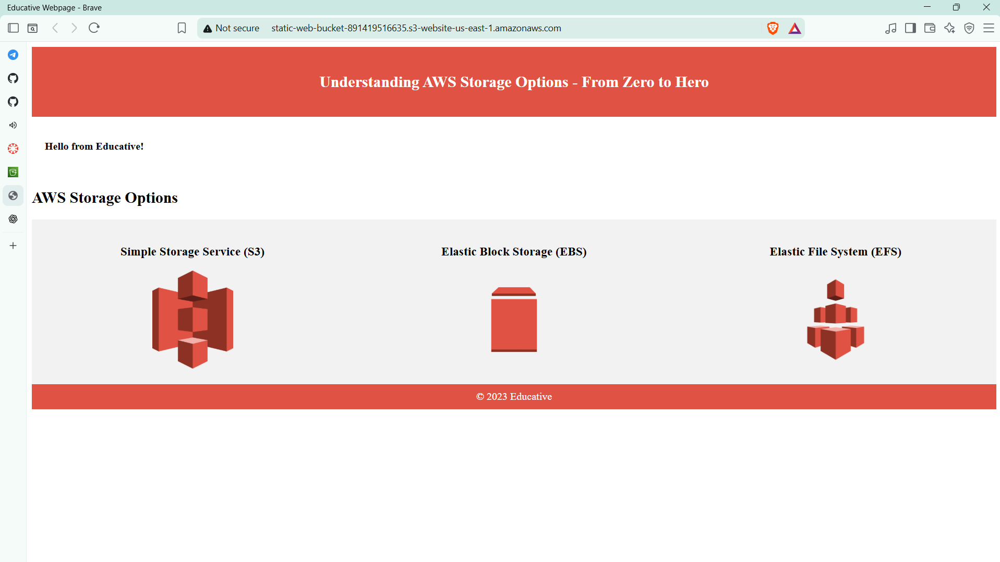
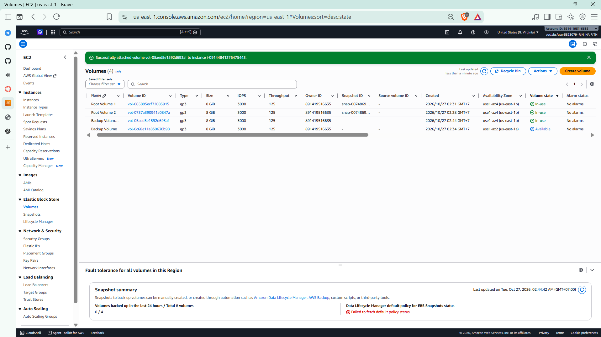
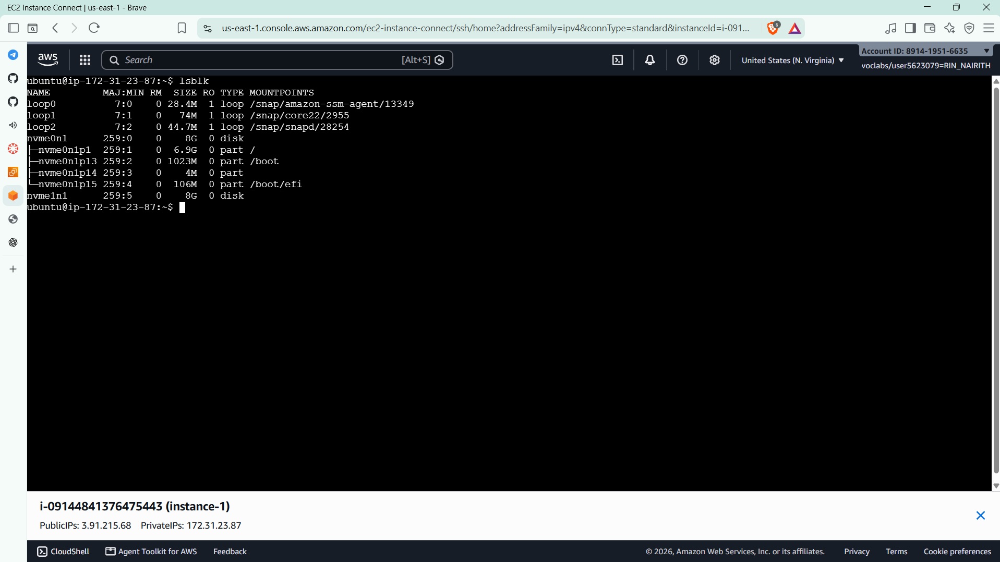
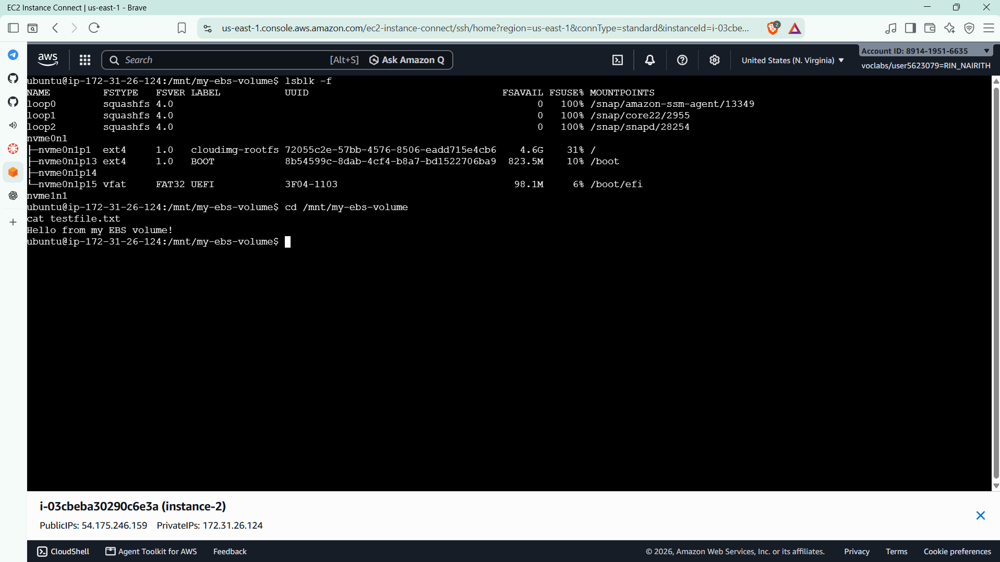
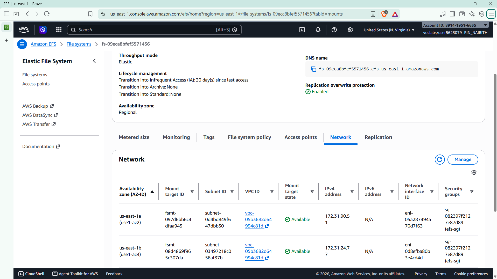
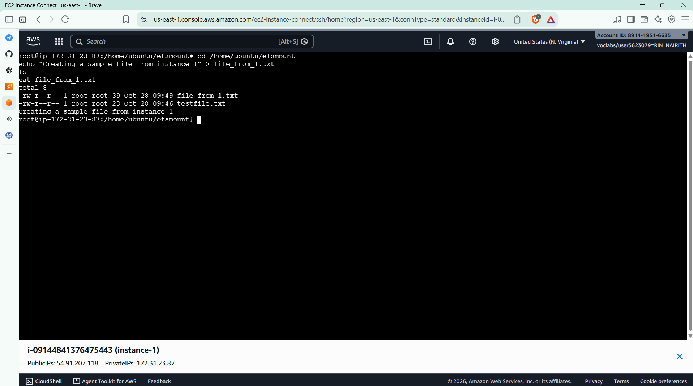
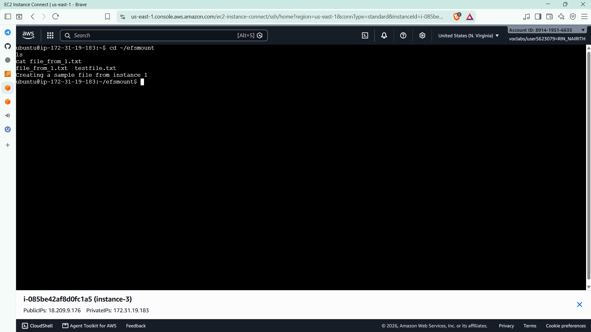

# Cloud Lab 3 Submission: AWS Storage Options

| | |
| --- | --- |
| **Student name** | Rin Nairith |
| **Student ID** | e20221557 |
| **Learner Lab user name** | voclabs/user5623079=RIN_NAIRITH |
| **Date completed** | 2026-10-28 |
| **Region** | US East (N. Virginia) `us-east-1` |

---

## Part 2.1: Amazon S3

### Bucket list

### Uploaded files

### Static website

---

## Part 2.2: Amazon EBS

### Volumes page

### Attached volume (`lsblk`)

> Device name: `nvme1n1` (the 8 GiB disk with no partitions and no mount point).

### File read on instance-2

---

## Part 2.3: Amazon EFS

### File system and mount targets

### File created on instance-1

### File listed on instance-3

---

## Questions

1. **Why 403 Forbidden at first?** S3 objects are private by default. Turning off Block Public Access only allows a public policy; it does not grant access. After I added the bucket policy (`"Principal": "*"`, `"Action": "s3:GetObject"`), anonymous visitors could read the objects and the site loaded.
2. **File on the root volume after terminating instance-1?** It would be lost. The root volume has *Delete on termination* turned on, so it is deleted with the instance. **Backup Volume** is a separate volume, so it survives.
3. **Why `mkfs` only on instance-1?** The new volume was empty, so it needed an `ext4` file system first. On instance-2 the volume already had that file system and `testfile.txt`; running `mkfs` again would erase it.
4. **Why could two instances share EFS but not EBS?** EFS is a network file system (NFS), so many instances can mount it at the same time. An EBS volume is a block disk attached to one instance, so it must be detached first. Each instance reaches EFS through the mount target in its own Availability Zone, so the instances had to be in the subnets that have mount targets (us-east-1a and us-east-1b).
5. **Choose a storage service:**
   - (a) Website images: **S3**, cheap and durable object storage that can serve files over HTTP.
   - (b) Database server disk: **EBS**, a low-latency block disk attached to one server.
   - (c) Folder shared by several web servers: **EFS**, a shared file system many instances can mount at once.

---

## Clean up

- [x] Instances `instance-1`, `instance-2`, `instance-3` terminated.
- [x] `clab-efs` and **Backup Volume** deleted.
- [x] Security groups `efs-sg` and `ec2instances-sg` deleted.
- [x] S3 bucket emptied and deleted.
