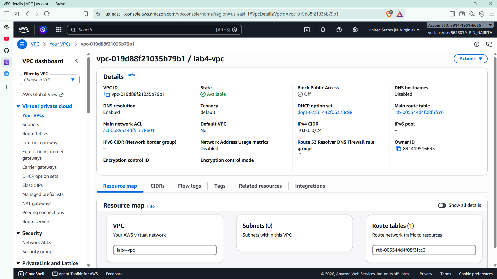
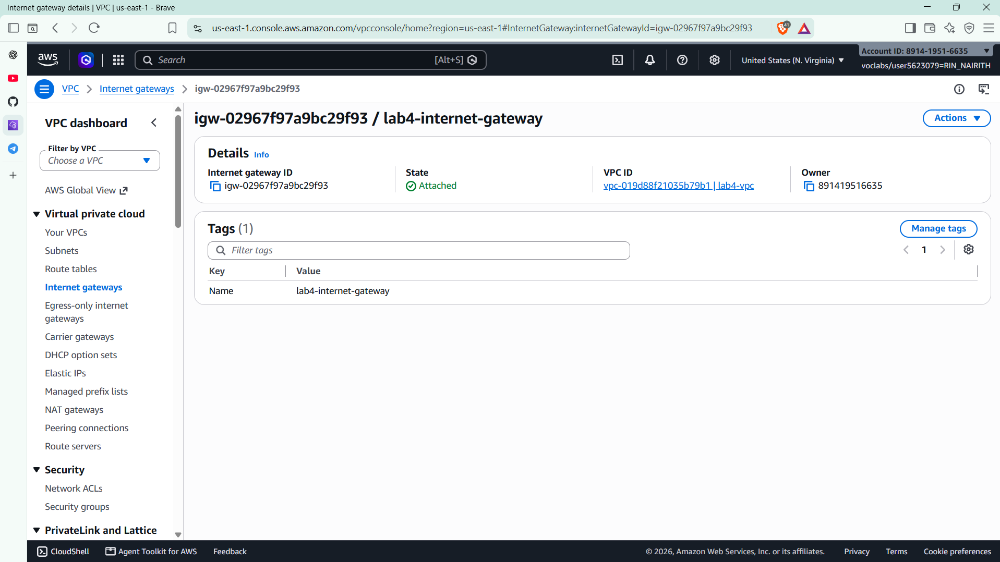
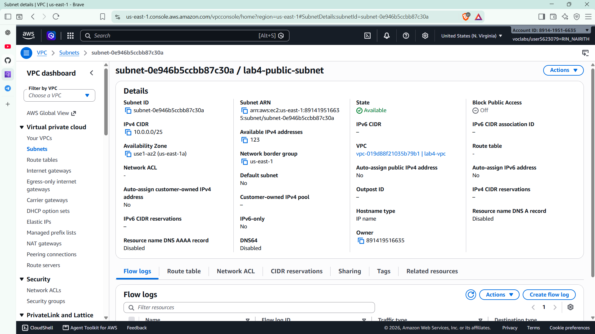
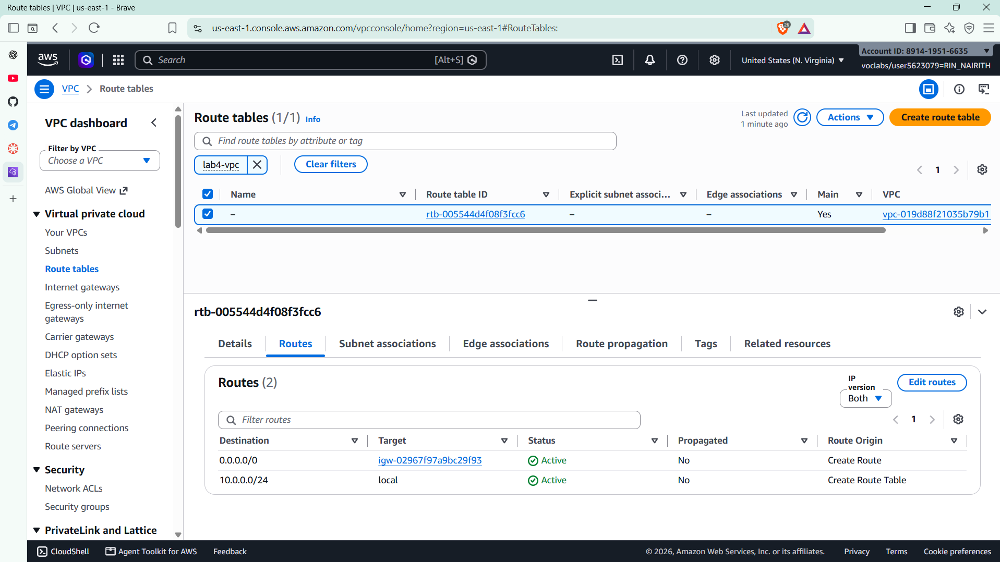
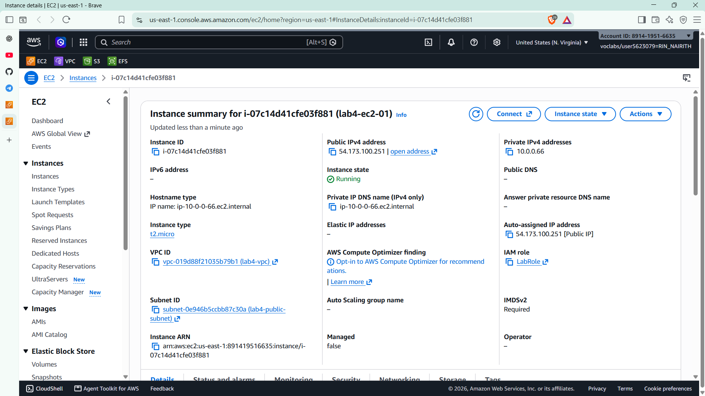
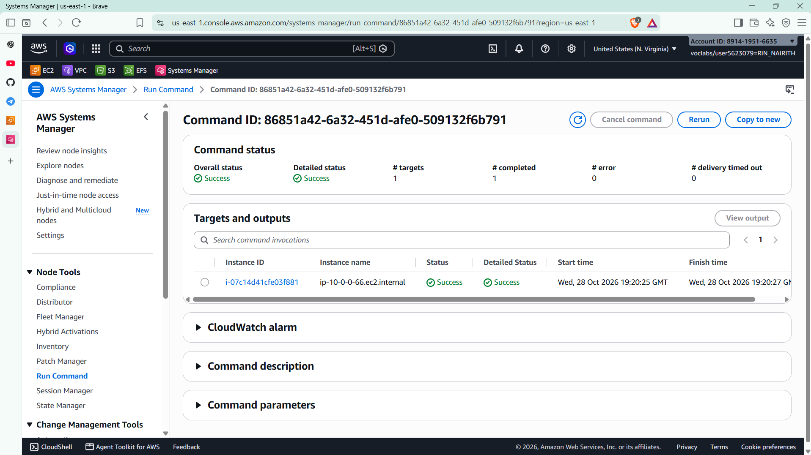
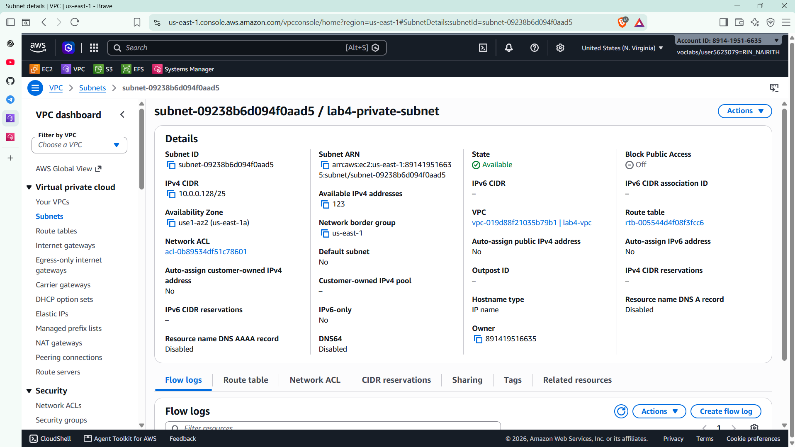
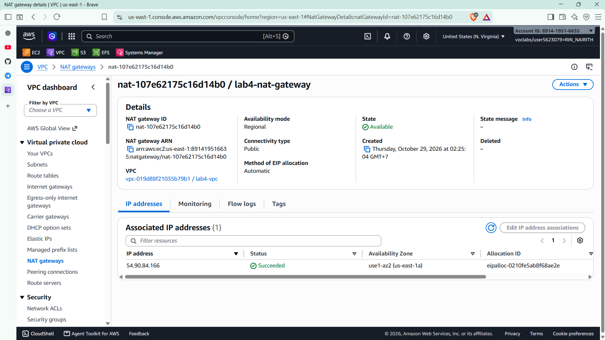
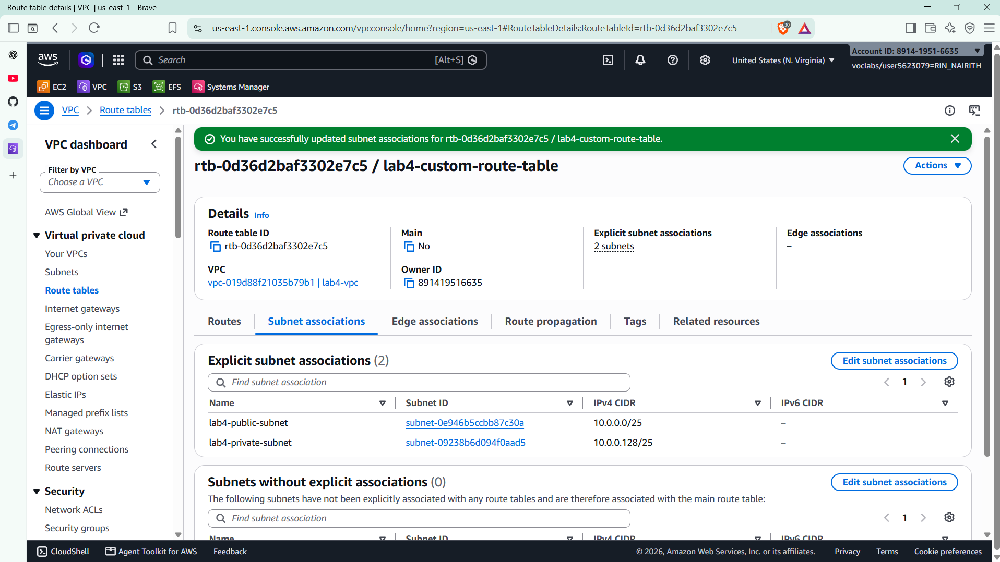
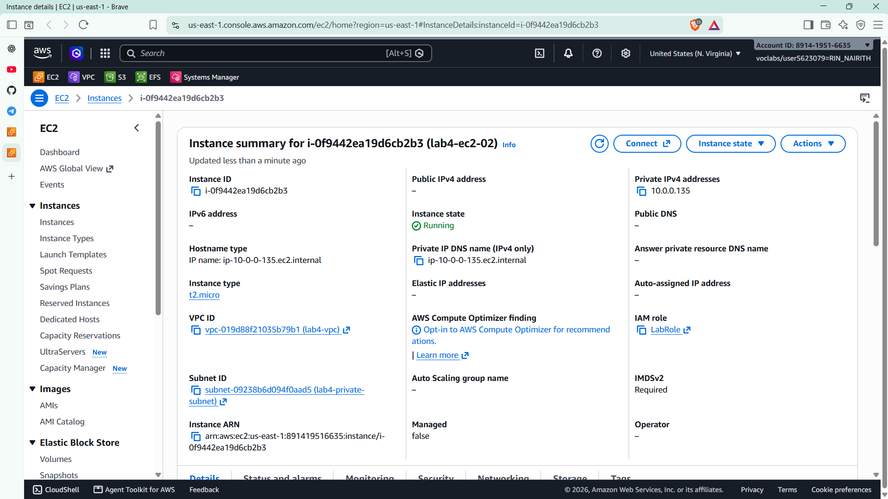

# Cloud Lab 4 Submission: Amazon VPC

| | |
| --- | --- |
| **Student name** | Rin Nairith |
| **Student ID** | e20221557 |
| **Learner Lab user name** | voclabs/user5623079=RIN_NAIRITH |
| **Date completed** | 2026-10-29 |
| **Region** | US East (N. Virginia) `us-east-1` |

---

## VPC and internet gateway

## Public subnet

## Private subnet

---

## Questions

1. **How many IP addresses, and why no overlap?** `10.0.0.0/24` has 2^8 = **256** addresses. Each `/25` has 2^7 = **128** addresses; AWS reserves 5 in every subnet, so **123** are usable (shown in `03` and `07`). `10.0.0.0/25` covers `10.0.0.0` to `10.0.0.127` and `10.0.0.128/25` covers `10.0.0.128` to `10.0.0.255`, so they are the two halves of the VPC and do not share any address.
2. **What makes a subnet public or private?** Its **route table**. `lab4-public-subnet` uses a route table with `0.0.0.0/0` → `lab4-internet-gateway`, so its instances (with a public IP) talk to the internet directly. `lab4-private-subnet` uses `lab4-custom-route-table`, where `0.0.0.0/0` goes to `lab4-nat-gateway` and there is no route to the internet gateway.
3. **Why is the NAT gateway in the public subnet?** The NAT gateway itself must reach the internet. Only the public subnet has the `0.0.0.0/0` → internet gateway route, and the NAT gateway uses its Elastic IP to talk to the internet on behalf of private instances. In the private subnet it would have no path out.
4. **Can the internet reach `lab4-ec2-02`? Can it download updates?** **No** inbound: it has no public IP, and the NAT gateway only lets through replies to connections that started inside the VPC. **Yes** outbound: its traffic goes to the NAT gateway, which forwards it to the internet with its Elastic IP. `sudo yum update -y` succeeded in `11`.
5. **Why `LabInstanceProfile`?** Run Command works through the SSM Agent on the instance, which calls the Systems Manager service. The instance profile gives the instance the `LabRole` permissions to register with Systems Manager and receive commands. Without it, the instance is not a managed node and cannot be selected. This also means no SSH key or inbound port is needed.

---

## Clean up

- [x] Instances terminated.
- [x] NAT gateway deleted and its Elastic IP released.
- [x] Internet gateway detached and deleted.
- [x] `lab4-vpc` deleted.
