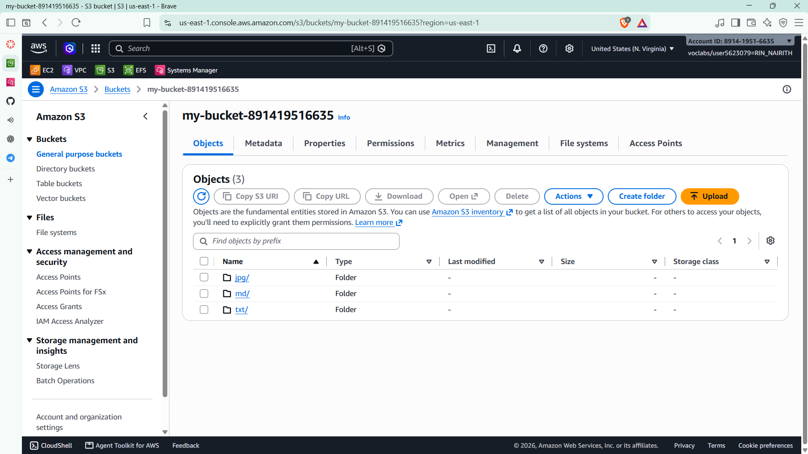
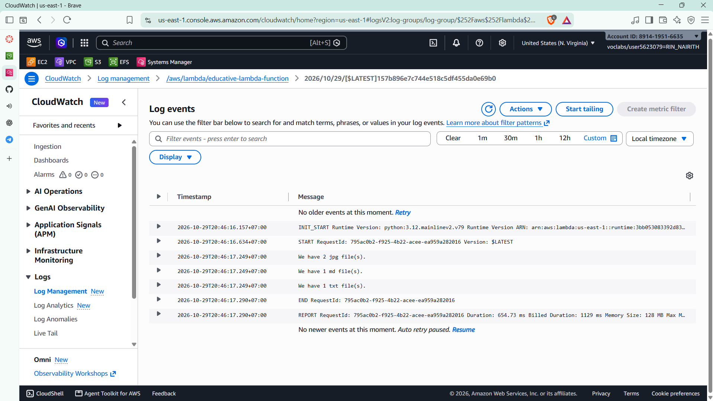

# Cloud Lab 5 Submission: AWS Lambda and S3 Event Triggers

| | |
| --- | --- |
| **Student name** | Rin Nairith |
| **Student ID** | e20221557 |
| **Learner Lab user name** | voclabs/user5623079=RIN_NAIRITH |
| **Bucket name** | `my-bucket-891419516635` |
| **Date completed** | 2026-10-29 |
| **Region** | US East (N. Virginia) `us-east-1` |

---

## S3 bucket



The bucket `my-bucket-891419516635` holds the uploaded objects. The Lambda function organized them by file type into the `jpg/`, `md/` and `txt/` prefixes.

## Lambda function

The function `educative-lambda-function` runs on **Python 3.12** with **128 MB** of memory. Its code is in [lambda_function.py](lambda_function.py), and it is invoked by an **S3 `ObjectCreated` trigger** on the bucket.

For every event it:

1. reads the bucket name and object key from `event['Records'][0]['s3']`;
2. extracts the file extension and builds a new key `<extension>/<file name>`;
3. copies the object to the new key with `copy_object` and deletes the original with `delete_object`;
4. lists the bucket, counts the objects under each top-level prefix, and prints one line per file type.

> Because the function writes back into the same bucket that triggers it, the notification has to be scoped to the upload location (or a separate destination bucket used). Otherwise the copied object can create another event and invoke the function again.

## CloudWatch logs



The function's `print()` output goes to the log group `/aws/lambda/educative-lambda-function`. The stream for 2026/10/29 shows:

```text
We have 2 jpg file(s).
We have 1 md file(s).
We have 1 txt file(s).
```

The `REPORT` line shows **654.73 ms** duration, **1129 ms** billed duration and **128 MB** memory.

---

## Questions

1. **What is the trigger, and how does the function know which object changed?** The trigger is an S3 event notification for object creation on `my-bucket-891419516635`. S3 invokes the function asynchronously and passes an event whose `Records[0].s3.bucket.name` and `Records[0].s3.object.key` identify the new object; the handler reads those fields instead of a hard-coded file name.
2. **What does the function do?** It takes the extension of the uploaded key (`os.path.splitext(...)[1][1:].lower()`), copies the object to `<extension>/<file name>`, deletes the original key, then lists the bucket and counts the files in each folder. It returns the `(folder, count)` pairs.
3. **Why copy and then delete instead of renaming?** S3 has no rename operation: an object's key is part of its identity. Moving an object means copying it to the new key (`copy_object`) and deleting the old key (`delete_object`), which is exactly what the handler does.
4. **Why does the Lambda function need an execution role?** Lambda assumes an IAM role and gives the function temporary credentials. The function's `boto3` S3 client uses those credentials, so the role must allow the S3 actions used here (`s3:GetObject`, `s3:PutObject`, `s3:DeleteObject`, `s3:ListBucket`) plus writing to CloudWatch Logs. In the Learner Lab, `LabRole` supplies these permissions.
5. **Where do the log messages come from?** `print()` writes to standard output, which Lambda sends to CloudWatch Logs. Each invocation creates `START`, `END` and `REPORT` records plus the function's own lines; the screenshot shows the final counts and the billed duration.

---

## Clean up

- [x] Lambda function `educative-lambda-function` deleted.
- [x] S3 bucket `my-bucket-891419516635` emptied and deleted.
- [x] Lambda execution role deleted.
- [x] CloudWatch log group deleted.
