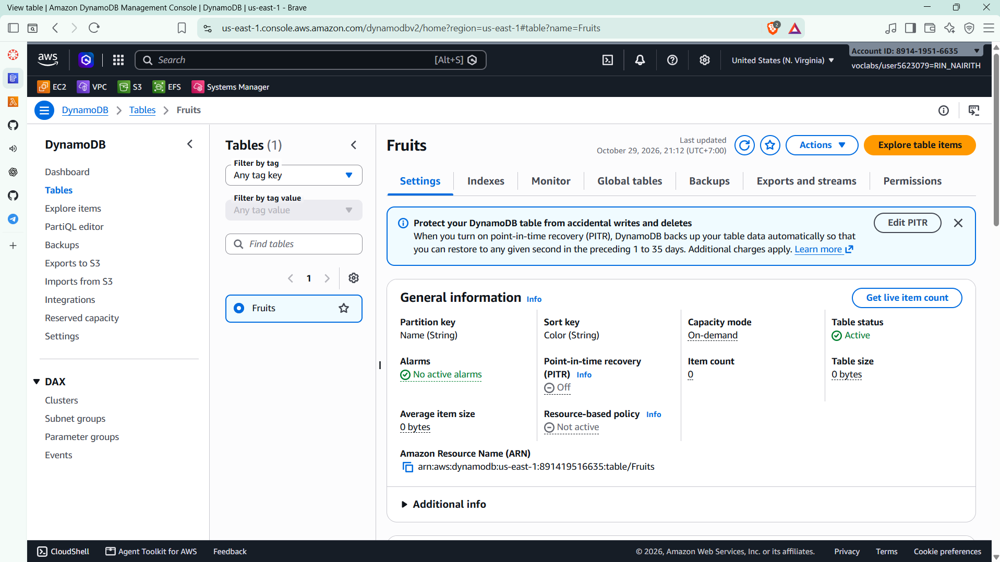
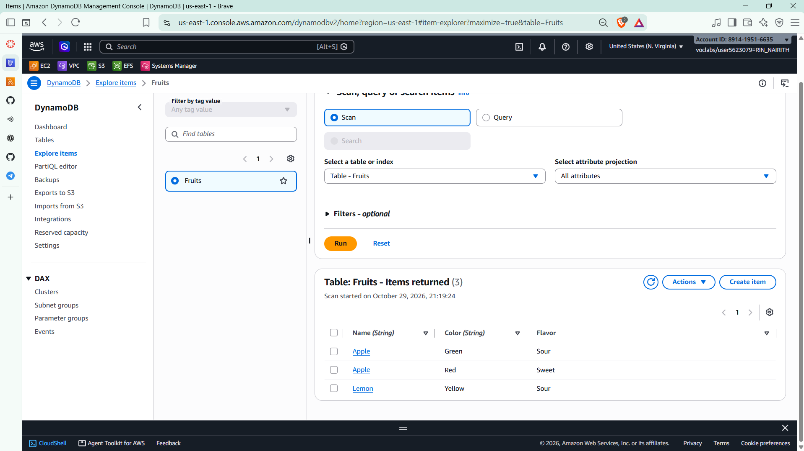
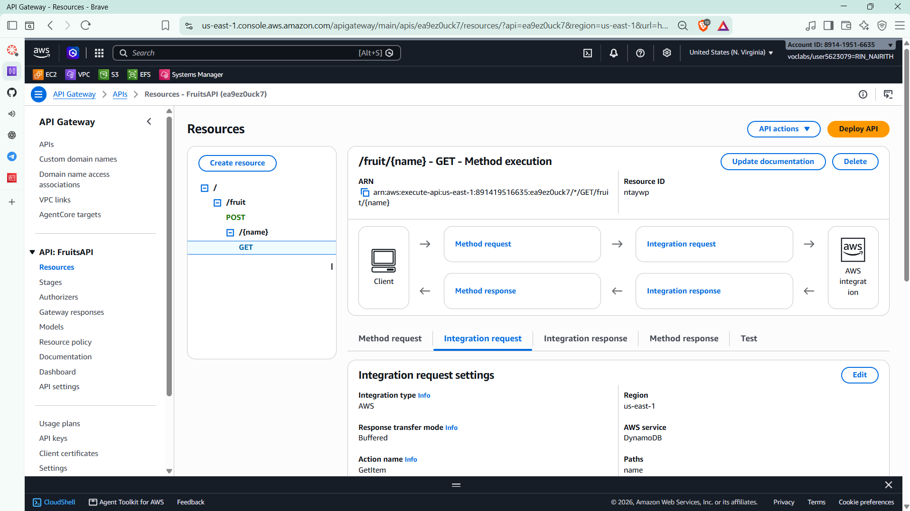
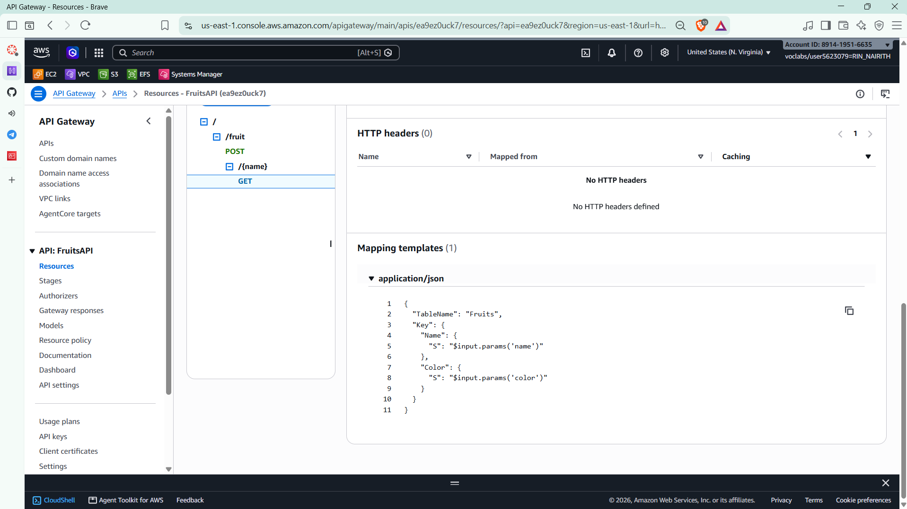
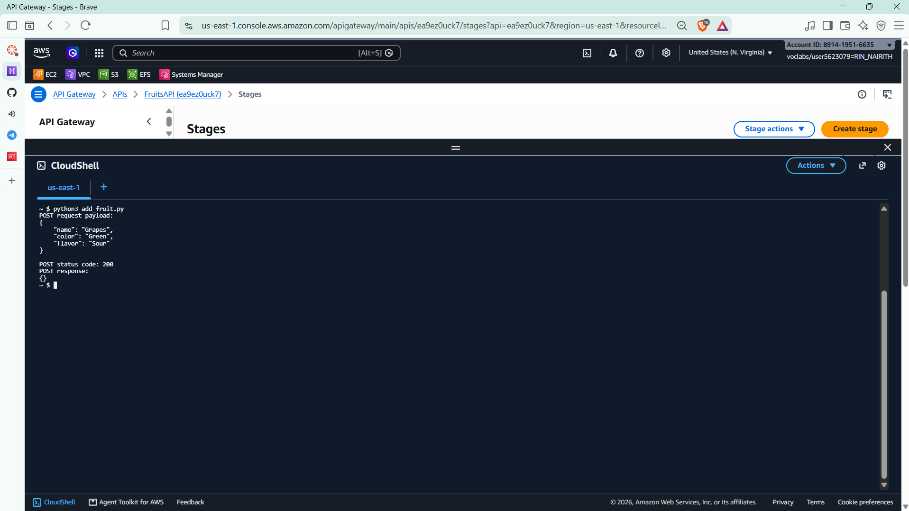
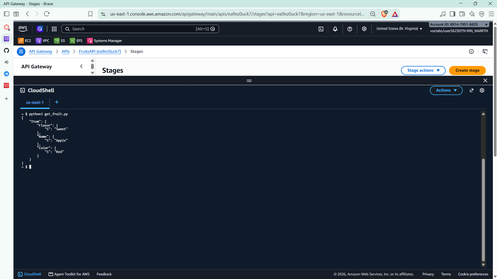
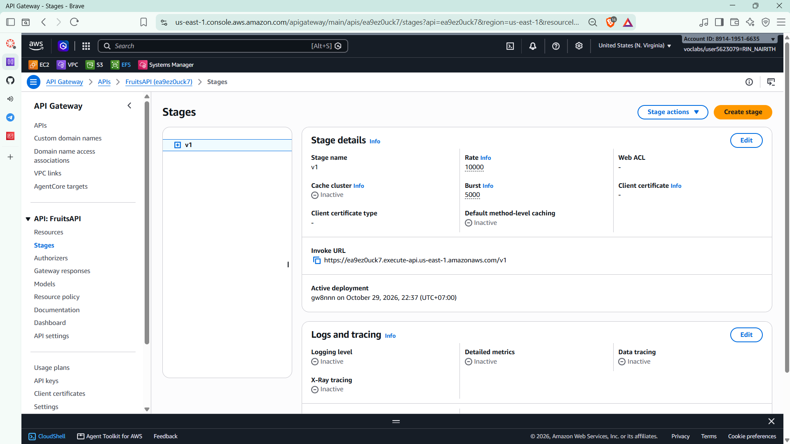

# Cloud Lab 6 Submission: API Gateway and DynamoDB

| | |
| --- | --- |
| **Student name** | Rin Nairith |
| **Student ID** | e20221557 |
| **Learner Lab user name** | voclabs/user5623079=RIN_NAIRITH |
| **Table name** | `Fruits` |
| **API name** | `FruitsAPI` |
| **Date completed** | 2026-10-29 |
| **Region** | US East (N. Virginia) `us-east-1` |

---

## DynamoDB table



Partition key `Name`, sort key `Color`, on-demand capacity.

## Items



[populate_table.py](populate_table.py) inserted Apple (Red, Sweet), Apple (Green, Sour) and Lemon (Yellow, Sour).

## API Gateway



- `POST /fruit` → DynamoDB `PutItem`
- `GET /fruit/{name}` → DynamoDB `GetItem`

## GET mapping template



```json
{
  "TableName": "Fruits",
  "Key": {
    "Name": { "S": "$input.params('name')" },
    "Color": { "S": "$input.params('color')" }
  }
}
```

## POST test



Grapes / Purple / Sweet → **HTTP 200**.

## GET test



Returned Apple / Red / Sweet.

## Deployment



Stage `v1`: `https://ea9ez0uck7.execute-api.us-east-1.amazonaws.com/v1`

---

## Questions

1. **Why a composite key?** `Name` alone would overwrite the second Apple; `(Name, Color)` keeps both.
2. **Why on-demand?** No capacity planning, scales automatically and charges per request.
3. **How does API Gateway call DynamoDB without Lambda?** AWS service integration with an IAM role and mapping templates.
4. **What does the GET template do?** Maps `{name}` and `?color=` into the `GetItem` key.
5. **Why deploy?** The stage serves the last deployed snapshot, not unsaved changes.

---

## Clean up

- [x] `FruitsAPI` deleted.
- [x] `Fruits` table deleted.
- [x] API Gateway IAM role deleted.
