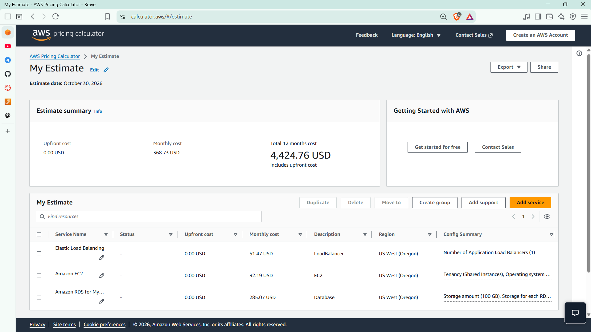
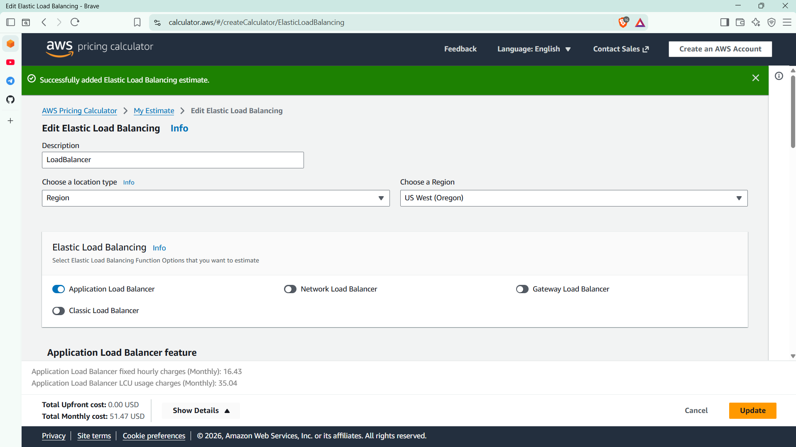
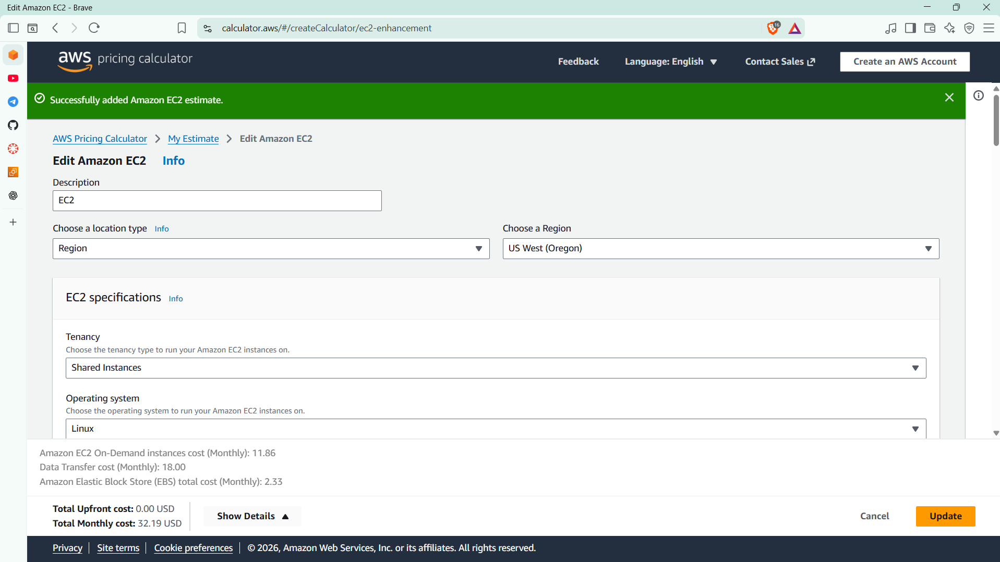
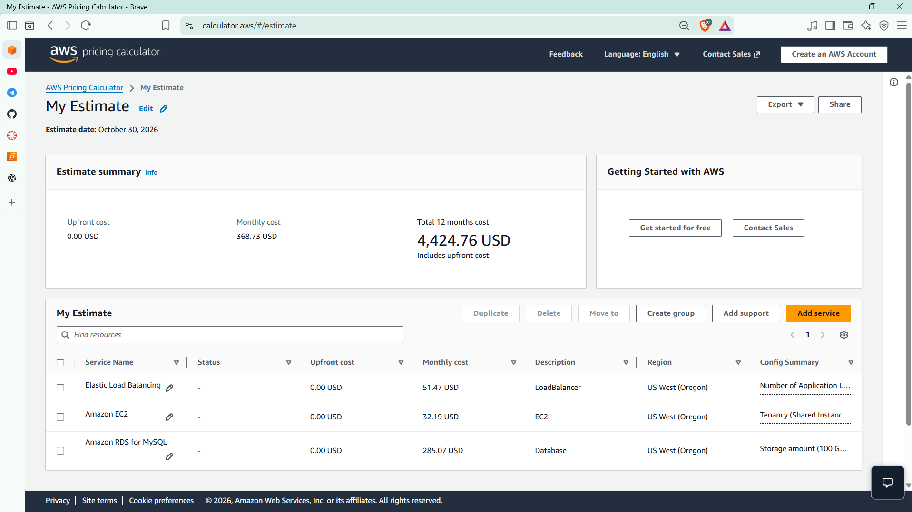
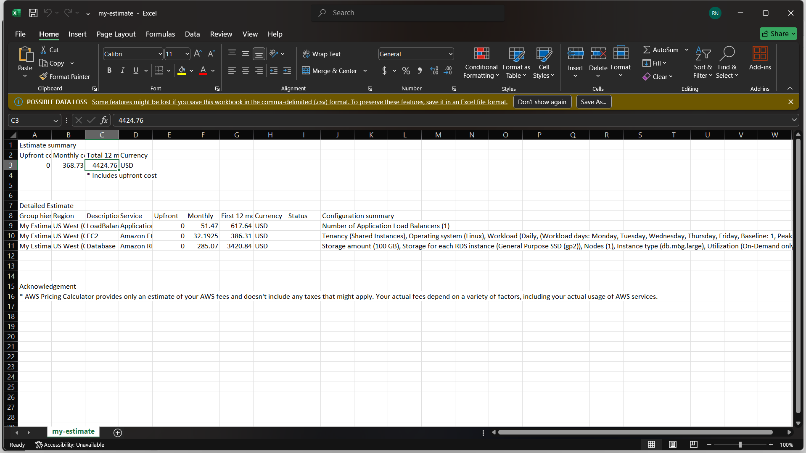
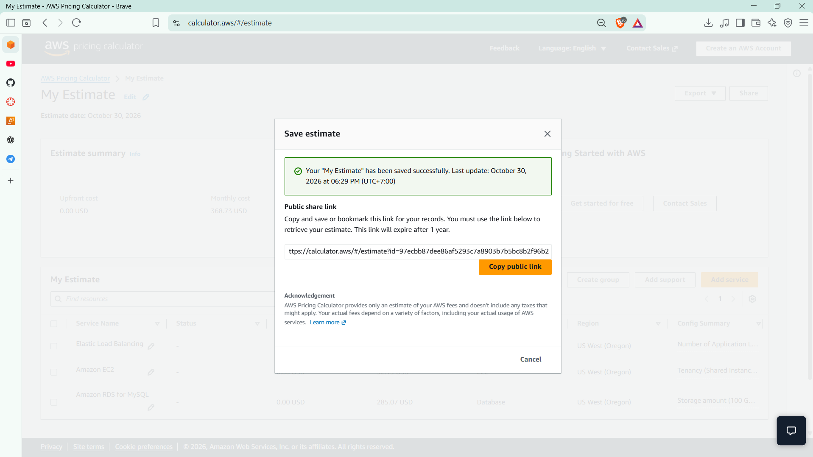

# Cloud Lab 8 Submission: AWS Pricing Calculator

| | |
| --- | --- |
| **Student name** | Rin Nairith |
| **Student ID** | e20221557 |
| **Learner Lab user name** | voclabs/user5623079=RIN_NAIRITH |
| **Estimate region** | US West (Oregon) `us-west-2` |
| **Date completed** | 2026-10-30 |

**Estimate:** <https://calculator.aws/#/estimate?id=97ecbb87dee86af5293c7a8903b7b5bc8b2f96b2>

---

## Services added

| Service | Configuration | Monthly |
| --- | --- | ---: |
| Application Load Balancer | 1 ALB | $51.47 |
| Amazon EC2 | `t4g.small`, Linux, on-demand | $32.19 |
| Amazon RDS for MySQL | `db.m6g.large`, Multi-AZ, 100 GB gp2 | $285.07 |
| **Total** | | **$368.73** |

Upfront cost is **$0.00**; total for 12 months is **$4,424.76 USD**.

## Application Load Balancer

One ALB in US West (Oregon): **$16.43** fixed hourly charge plus **$35.04** LCU usage per month.

## Amazon EC2

- `t4g.small`, shared tenancy, Linux, on-demand
- Weekdays only: baseline 1 instance, peak 2 instances for 8 h 30 min
- 30 GB EBS, 50 GB inbound, 200 GB outbound

Monthly cost: **$11.86** compute + **$18.00** data transfer + **$2.33** EBS = **$32.19**.

## Amazon RDS for MySQL

No separate screenshot; the settings are shown in the summary and CSV:

- `db.m6g.large`, MySQL, **Multi-AZ**, 100 GB gp2 storage, 1 node
- On-demand, 100% utilized per month
- **$285.07** per month, **$3,420.84** for 12 months

## Estimate summary

## CSV export

The exported file is [estimate.csv](estimate.csv).

## Share link

<https://calculator.aws/#/estimate?id=97ecbb87dee86af5293c7a8903b7b5bc8b2f96b2>

The link is public and expires after one year.

---

## Questions

1. **What does the estimate cover?** One ALB, one EC2 workload and one Multi-AZ MySQL RDS instance in US West (Oregon), priced on-demand for 12 months.
2. **Which service costs the most?** RDS at **$285.07/month** (about 77% of the total) because Multi-AZ runs a standby copy and includes 100 GB of storage.
3. **Why is EC2 not just instance hours?** The monthly total also includes 200 GB of outbound data transfer and 30 GB of EBS storage.
4. **Why use the Pricing Calculator?** To estimate and compare architectures before deploying, then export the result or share it with a link.
5. **Is this the final bill?** No. It excludes taxes and uses assumed usage; actual charges depend on real consumption.
