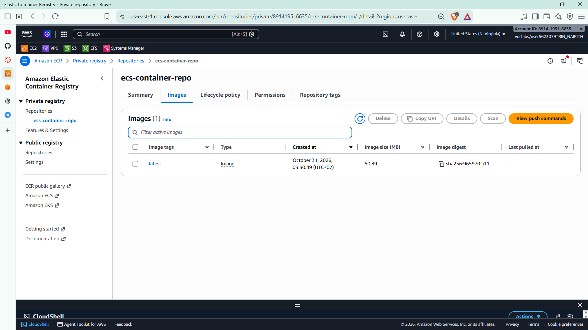
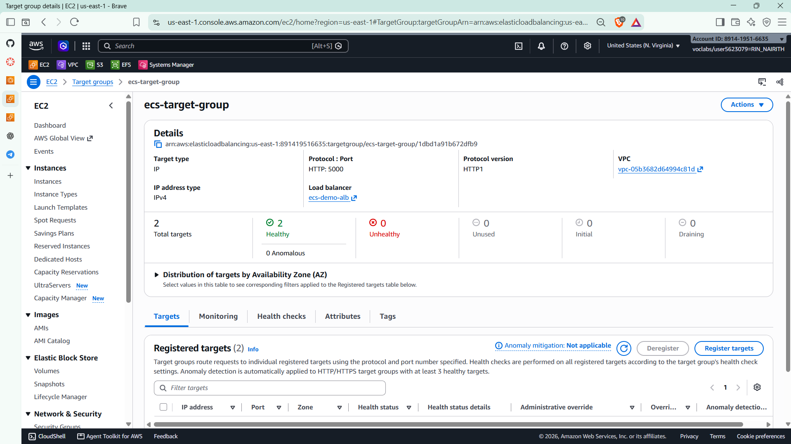
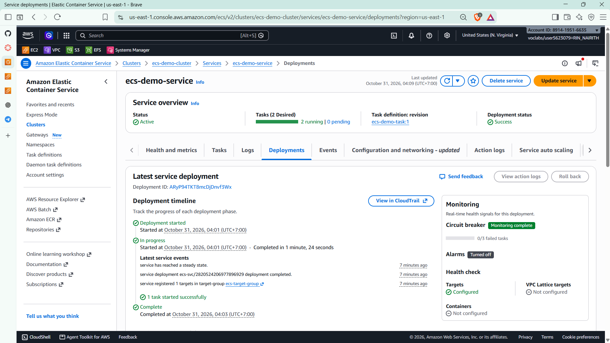
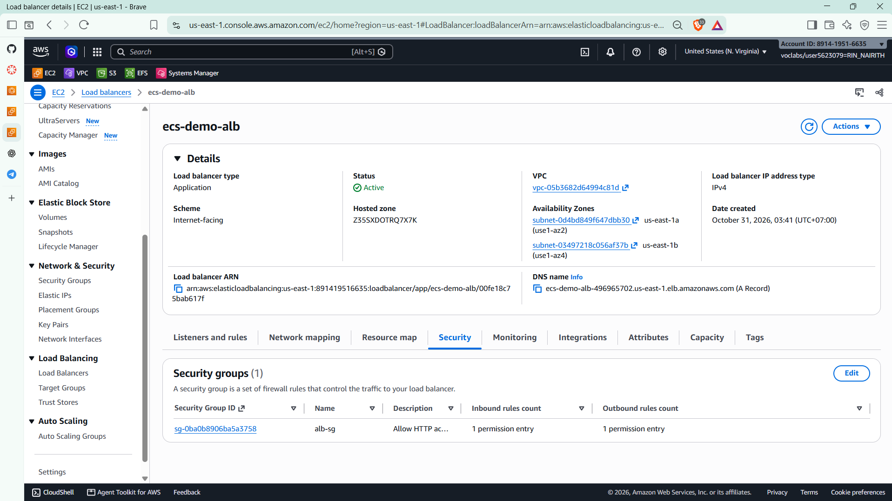
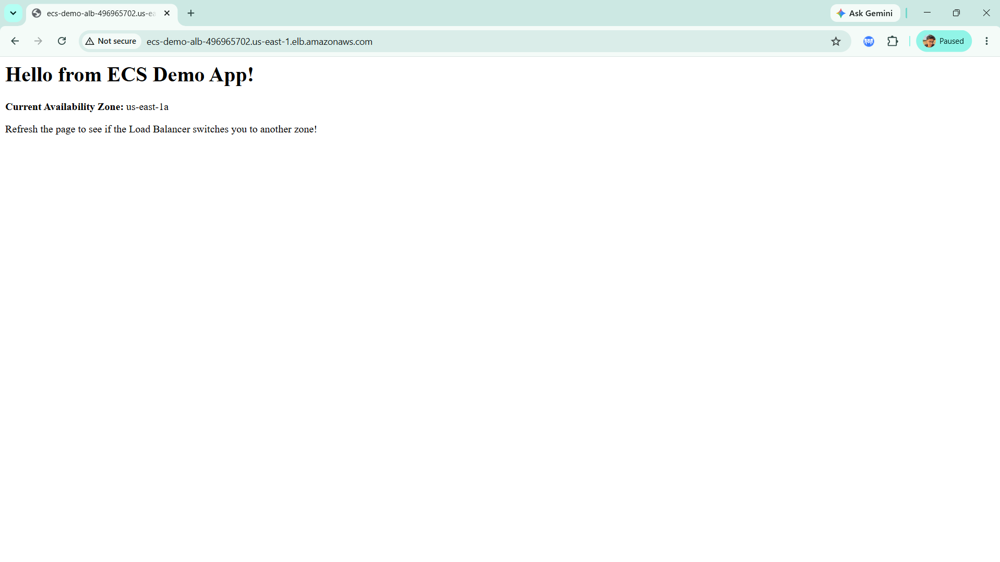
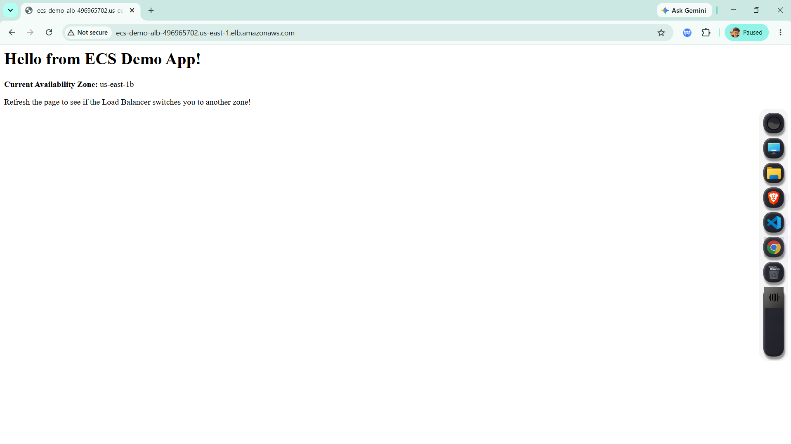

# Cloud Lab 9 Submission: Amazon ECS with ECR and ALB

| | |
| --- | --- |
| **Student name** | Rin Nairith |
| **Student ID** | e20221557 |
| **Learner Lab user name** | voclabs/user5623079=RIN_NAIRITH |
| **ECR repository** | `ecs-container-repo` |
| **ECS cluster** | `ecs-demo-cluster` |
| **Date completed** | 2026-10-31 |
| **Region** | US East (N. Virginia) `us-east-1` |

---

## Application

The Flask app in [app/app.py](app/app.py) returns a page with the task's Availability Zone, which it reads from the ECS task metadata endpoint (`ECS_CONTAINER_METADATA_URI_V4`). It listens on port **5000**.

[app/Dockerfile](app/Dockerfile) builds the image from `python:3.12-slim`.

## ECR repository

The private repository `ecs-container-repo` contains the `latest` image (50.39 MB), pushed on October 31, 2026 at 03:30 (UTC+07:00).

## Target group

`ecs-target-group` uses **IP targets** on **HTTP port 5000** in the lab VPC. Both registered targets are **healthy** and attached to the `ecs-demo-alb` load balancer.

## ECS service

- Cluster: `ecs-demo-cluster`
- Service: `ecs-demo-service`
- Task definition: `ecs-demo-task:1`
- Desired/running tasks: **2 / 2**
- Deployment status: **Success**

The latest deployment started at 04:01 and reached a steady state at 04:03 (UTC+07:00).

## Load balancer

`ecs-demo-alb` is an **internet-facing Application Load Balancer** in the lab VPC. It spans two Availability Zones:

- `us-east-1a` — `subnet-0d4bd849f647dbb30`
- `us-east-1b` — `subnet-03497218c056af37b`

The DNS name is `ecs-demo-alb-496965702.us-east-1.elb.amazonaws.com`, and the `alb-sg` security group allows HTTP traffic.

## Test

Opening the ALB DNS name in a browser loads **Hello from ECS Demo App!** Refreshing shows **us-east-1a** and then **us-east-1b**, which confirms the load balancer is sending requests to tasks in both zones.

---

## Questions

1. **Why push the image to ECR?** ECR is private, in the same region as ECS, and access is controlled by IAM. ECS can pull the image directly without a public registry.
2. **What is the difference between a task definition and a service?** The task definition is the blueprint (image, CPU, memory, port); the service keeps the desired number of tasks running and registers them with the load balancer.
3. **Why does the target group use IP targets?** ECS tasks have their own network interface, so the target group registers the task's IP address and port 5000 instead of an EC2 instance ID.
4. **How does the load balancer serve two zones?** The ALB has subnets in `us-east-1a` and `us-east-1b`; the ECS service places tasks in those zones, and the target group routes to the healthy task IPs.
5. **Why run two tasks?** Desired count 2 keeps the app available if one task or one zone fails. The service replaces unhealthy tasks to return to the desired count.
6. **How does the page know its zone?** The container reads `ECS_CONTAINER_METADATA_URI_V4`, calls the task metadata endpoint, and returns the `AvailabilityZone` field from the response.

---

## Clean up

- [x] ECS service and cluster deleted.
- [x] Application Load Balancer and target group deleted.
- [x] ECR repository deleted.
- [x] EC2 build instance terminated.
- [x] Security groups deleted.
